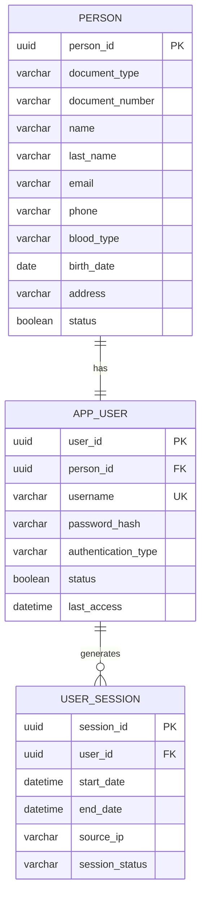

# Domain: Identity

> **Owner:** Identity bounded context
> **DB Engine:** PostgreSQL 17 — ACID transactions, relational integrity, multi-tenant isolation
>
> **Engine justification:**
> - Strong relational guarantees for person-user relationships.
> - UUID primary keys for distributed ID generation across microservices.
> - TIMESTAMP (no time zone) for audit fields, filled by `fn_audit_timestamps()`.
> - Optimistic locking via `row_version` for concurrent update safety.

---

## 1. Table: city — DEPRECATED (legacy, still deployed)

> **Deprecated:** `identity.city` was removed from the relational model — cities come from the
> external API `countriesnow.space` (see `academic.school.city_id`). The table is still created
> by `01-ms-identity-db/01-ddl/03-tables/001-create-city-table.yaml` and Kong still routes
> `GET/POST/PUT/DELETE /api/v1/cities` to `ms-identity` (marked `deprecated: true` in
> `07-api/contracts/openapi/01-identity-service.yaml`). Treat it as read-only legacy pending
> removal; do not build new features on it. `academic.school.city_id` is `VARCHAR NULL` with no
> FK (see `03-academic.md`).

---

## 2. Table: person

**Purpose:** Generic record of any person in the system (student, instructor, admin, etc.).

```sql
CREATE TABLE person (
  -- Business fields
  person_id         UUID        PRIMARY KEY DEFAULT gen_random_uuid(),
  document_number   VARCHAR     NOT NULL,
  name              VARCHAR     NOT NULL,
  last_name         VARCHAR     NOT NULL,
  email             VARCHAR,
  phone             VARCHAR,
  document_type     VARCHAR     NULL CHECK (document_type IN ('CC','TI','CE','PP')),
  blood_type        VARCHAR     NULL CHECK (blood_type IN ('A+','A-','B+','B-','AB+','AB-','O+','O-')),
  birth_date        DATE        NULL,
  address           VARCHAR     NULL,

  -- Status fields
  status            BOOLEAN     NOT NULL DEFAULT true,

  -- Audit (in all tables)
  created_at        TIMESTAMP NOT NULL DEFAULT NOW(),
  updated_at        TIMESTAMP NOT NULL DEFAULT NOW(),
  deleted_at        TIMESTAMP,
  created_by        UUID,
  updated_by        UUID,
  deleted_by        UUID,
  row_version       BIGINT      NOT NULL DEFAULT 1
);

-- Real uniqueness is the pair (document_type, document_number):
-- CC and TI may share numbering across different persons.
CREATE UNIQUE INDEX uq_person_document ON person (document_type, document_number);
-- Partial UNIQUE (deployed as id-008-person-email-unique-index): login resolves an email to
-- one app_user; NULLs allowed and a soft-deleted person frees its email for reuse.
CREATE UNIQUE INDEX uq_person_email ON person (email) WHERE deleted_at IS NULL;
CREATE INDEX idx_person_deleted ON person (deleted_at) WHERE deleted_at IS NULL;
```

**Data dictionary:**

| Column | Type | Description | Example |
|--------|------|-------------|---------|
| person_id | UUID | Auto-generated unique identifier | `550e8400-e29b-41d4-a716-446655440001` |
| document_number | VARCHAR | National ID / document number (unique with document_type) | `1234567890` |
| name | VARCHAR | First name(s) | `Juan` |
| last_name | VARCHAR | Last name(s) | `Perez` |
| email | VARCHAR | Email address | `juan@example.com` |
| phone | VARCHAR | Phone number | `+57 300 987 6543` |
| document_type | VARCHAR | Document type CHECK: CC/TI/CE/PP | `CC` |
| blood_type | VARCHAR | Blood type CHECK: A+/A-/B+/B-/AB+/AB-/O+/O- | `O+` |
| birth_date | DATE | Birth date | `2000-05-10` |
| address | VARCHAR | Home address | `Calle 123 #45-67` |
| status | BOOLEAN | Active/inactive flag | `true` |
| created_at | TIMESTAMP | When the record was created | `2024-01-15T10:30:00Z` |
| updated_at | TIMESTAMP | When the record was last updated | `2024-01-15T10:30:00Z` |
| deleted_at | TIMESTAMP | NULL = active; with value = soft-deleted | `NULL` |
| created_by | UUID | User who created this record | `550e8400-...` |
| updated_by | UUID | User who last updated this record | `550e8400-...` |
| deleted_by | UUID | User who soft-deleted this record | `NULL` |
| row_version | BIGINT | Optimistic lock version counter | `1` |

**Modeling decisions:**
1. Real uniqueness is `(document_type, document_number)` — CC and TI may share numbering across different persons.
2. No `school_id` — identity is school-agnostic; a person can exist in multiple schools via `academic_actor`.
3. Soft delete via `deleted_at` preserves history; `deleted_by` tracks who removed it.
4. `document_type` / `blood_type` are VARCHAR + CHECK (not native ENUM). `authentication_type` and `session_status` are native PostgreSQL ENUMs (DBML documents them as `varchar + note`).

---

## 3. Table: app_user

**Purpose:** Login credentials and authentication record. Linked 1:1 with Person.

```sql
-- Native ENUM: CREATE TYPE identity.authentication_type AS ENUM ('Local','Windows','External');
CREATE TABLE app_user (
  -- Business fields
  user_id             UUID        PRIMARY KEY DEFAULT gen_random_uuid(),
  person_id           UUID        NOT NULL UNIQUE,
  username            VARCHAR     NOT NULL,
  password_hash       VARCHAR     NOT NULL,
  authentication_type identity.authentication_type NOT NULL,
  status              BOOLEAN     NOT NULL DEFAULT true,
  last_access         TIMESTAMP,

  -- Audit (in all tables)
  created_at          TIMESTAMP NOT NULL DEFAULT NOW(),
  updated_at          TIMESTAMP NOT NULL DEFAULT NOW(),
  deleted_at          TIMESTAMP,
  created_by          UUID,
  updated_by          UUID,
  deleted_by          UUID,
  row_version         BIGINT      NOT NULL DEFAULT 1
);

CREATE UNIQUE INDEX uq_user_username ON app_user (username);
```

**Data dictionary:**

| Column | Type | Description | Example |
|--------|------|-------------|---------|
| user_id | UUID | Auto-generated unique identifier | `550e8400-e29b-41d4-a716-446655440002` |
| person_id | UUID | Linked person (1:1, FK → person) | `550e8400-...` |
| username | VARCHAR | Login username, globally unique | `jperez` |
| password_hash | VARCHAR | Hashed password (never plaintext) | `$2b$10$...` |
| authentication_type | VARCHAR | Auth method: Local, Windows, External | `Local` |
| status | BOOLEAN | Active/inactive flag | `true` |
| last_access | TIMESTAMP | Last login timestamp | `2024-06-01T08:15:00Z` |
| created_at | TIMESTAMP | When the record was created | `2024-01-15T10:30:00Z` |
| updated_at | TIMESTAMP | When the record was last updated | `2024-01-15T10:30:00Z` |
| deleted_at | TIMESTAMP | NULL = active; with value = soft-deleted | `NULL` |
| created_by | UUID | User who created this record | `550e8400-...` |
| updated_by | UUID | User who last updated this record | `550e8400-...` |
| deleted_by | UUID | User who soft-deleted this record | `NULL` |
| row_version | BIGINT | Optimistic lock version counter | `1` |

**Modeling decisions:**
1. 1:1 relationship with Person — each person has at most one user account.
2. `authentication_type` supports: Local (password), Windows (AD/LDAP), External (OAuth).
3. `last_access` enables inactive user detection and activity auditing.

---

## 4. Table: user_session

**Purpose:** Record of each user login session.

```sql
-- Native ENUM: CREATE TYPE identity.user_session_status AS ENUM ('Active','Closed');
CREATE TABLE user_session (
  -- Business fields
  session_id      UUID        PRIMARY KEY DEFAULT gen_random_uuid(),
  user_id         UUID        NOT NULL,
  start_date      TIMESTAMP NOT NULL,
  end_date        TIMESTAMP,
  source_ip       VARCHAR,

  -- Status fields
  session_status  identity.user_session_status NOT NULL,

  -- Audit (in all tables)
  created_at      TIMESTAMP NOT NULL DEFAULT NOW(),
  updated_at      TIMESTAMP NOT NULL DEFAULT NOW(),
  deleted_at      TIMESTAMP,
  created_by      UUID,
  updated_by      UUID,
  deleted_by      UUID,
  row_version     BIGINT      NOT NULL DEFAULT 1
);

CREATE INDEX idx_session_user ON user_session (user_id);
CREATE INDEX idx_session_status ON user_session (session_status);
```

**Data dictionary:**

| Column | Type | Description | Example |
|--------|------|-------------|---------|
| session_id | UUID | Auto-generated unique session identifier | `550e8400-...` |
| user_id | UUID | Session owner (FK → app_user) | `550e8400-...` |
| start_date | TIMESTAMP | Session start time | `2024-06-01T08:15:00Z` |
| end_date | TIMESTAMP | Session end time (NULL if active) | `NULL` |
| source_ip | VARCHAR | Client IP address | `192.168.1.100` |
| session_status | VARCHAR | State: Active or Closed | `Active` |
| created_at | TIMESTAMP | When the record was created | `2024-06-01T08:15:00Z` |
| updated_at | TIMESTAMP | When the record was last updated | `2024-06-01T08:15:00Z` |
| deleted_at | TIMESTAMP | NULL = active; with value = soft-deleted | `NULL` |
| created_by | UUID | User who created this record | `550e8400-...` |
| updated_by | UUID | User who last updated this record | `550e8400-...` |
| deleted_by | UUID | User who soft-deleted this record | `NULL` |
| row_version | BIGINT | Optimistic lock version counter | `1` |

---

## 5. Table: password_policy

**Purpose:** System password policy (complexity requirements, expiration).

```sql
CREATE TABLE password_policy (
  -- Business fields
  policy_id           SERIAL      PRIMARY KEY,
  min_length          INT         NOT NULL DEFAULT 8,
  max_length          INT         NOT NULL DEFAULT 20,
  requires_uppercase  BOOLEAN     NOT NULL DEFAULT true,
  requires_numbers    BOOLEAN     NOT NULL DEFAULT true,
  requires_symbols    BOOLEAN     NOT NULL DEFAULT true,
  expiration_days     INT         NOT NULL DEFAULT 90,

  -- Audit (in all tables)
  created_at          TIMESTAMP NOT NULL DEFAULT NOW(),
  updated_at          TIMESTAMP NOT NULL DEFAULT NOW(),
  deleted_at          TIMESTAMP,
  created_by          UUID,
  updated_by          UUID,
  deleted_by          UUID,
  row_version         BIGINT      NOT NULL DEFAULT 1
);
```

**Data dictionary:**

| Column | Type | Description | Example |
|--------|------|-------------|---------|
| policy_id | SERIAL | Auto-incremental policy identifier | `1` |
| min_length | INT | Minimum password length | `8` |
| max_length | INT | Maximum password length | `20` |
| requires_uppercase | BOOLEAN | Requires at least one uppercase letter | `true` |
| requires_numbers | BOOLEAN | Requires at least one number | `true` |
| requires_symbols | BOOLEAN | Requires at least one symbol | `true` |
| expiration_days | INT | Days before password expires | `90` |
| created_at | TIMESTAMP | When the record was created | `2024-01-15T10:30:00Z` |
| updated_at | TIMESTAMP | When the record was last updated | `2024-01-15T10:30:00Z` |
| deleted_at | TIMESTAMP | NULL = active; with value = soft-deleted | `NULL` |
| created_by | UUID | User who created this record | `550e8400-...` |
| updated_by | UUID | User who last updated this record | `550e8400-...` |
| deleted_by | UUID | User who soft-deleted this record | `NULL` |
| row_version | BIGINT | Optimistic lock version counter | `1` |

**Modeling decisions:**
1. Singleton table (one policy for the entire system) — not multi-tenant.
2. Sensible defaults adjustable by an administrator.

---

## 6. Relationship Diagram



> `CITY` is legacy in the deployed DB (deprecated in the DBML — cities come from the external `countriesnow.space` API). Uniqueness on person is `uq_person_document (document_type, document_number)` plus the partial unique `uq_person_email (email) WHERE deleted_at IS NULL`.

---

## 7. Cross-Context Relationships

| From | To | Reference Type | Mechanism |
|------|----|----------------|-----------|
| Authorization.User_Role.user_id | App_User.user_id | External ID (no FK) | Cross-context reference by UUID |
| Academic.Academic_Actor.person_id | Person.person_id | External ID (no FK) | Cross-context reference by UUID |
| Attendance.Justification.reviewed_by | App_User.user_id | External ID (no FK) | Cross-context reference by UUID |
| Configuration.Biometric_Update_Case.requested_by | App_User.user_id | External ID (no FK) | Cross-context reference by UUID |

---

## 8. Correlations

- Domain entities that map to these tables → `02-domain/entities-and-rules.md`
- Saga and Outbox pattern for distributed consistency → `05-architecture/pattern-guide.md`
- Data for each service in detail → `09-microservices/services/identity-service/data-model.md`
- How data is accessed via API → `07-api/contracts/openapi/`
