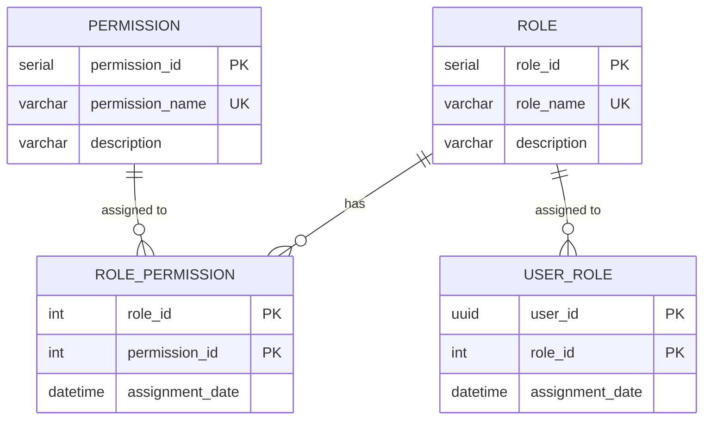

# Domain: Authorization

> **Owner:** Authorization bounded context
> **DB Engine:** PostgreSQL 17 — ACID transactions, relational integrity for role-permission associations
>
> **Engine justification:**
> - M:N relationships between roles, permissions, and users require relational integrity.
> - SERIAL primary keys for internal identifiers not exposed across services.

---

## Design Principles

- Authorization does **NOT** depend directly on Person.
- `user_id` acts as an external reference to the Identity context.
- Roles are **global** (no `school_id`) — the same role structure applies to all schools.

---

## 1. Table: role

**Purpose:** Definition of available roles in the system (e.g., Admin, Instructor, Student).

```sql
CREATE TABLE role (
  -- Business fields
  role_id       SERIAL      PRIMARY KEY,
  role_name     VARCHAR     NOT NULL UNIQUE,
  description   VARCHAR,

  -- Audit (in all tables)
  created_at    TIMESTAMP NOT NULL DEFAULT NOW(),
  updated_at    TIMESTAMP NOT NULL DEFAULT NOW(),
  deleted_at    TIMESTAMP,
  created_by    UUID,
  updated_by    UUID,
  deleted_by    UUID,
  row_version   BIGINT      NOT NULL DEFAULT 1
);
```

**Data dictionary:**

| Column | Type | Description | Example |
|--------|------|-------------|---------|
| role_id | SERIAL | Auto-incremental role identifier | `1` |
| role_name | VARCHAR | Unique role name | `ADMIN` |
| description | VARCHAR | Role description | `Full system administrator` |
| created_at | TIMESTAMP | When the record was created | `2024-01-15T10:30:00Z` |
| updated_at | TIMESTAMP | When the record was last updated | `2024-01-15T10:30:00Z` |
| deleted_at | TIMESTAMP | NULL = active; with value = soft-deleted | `NULL` |
| created_by | UUID | User who created this record | `550e8400-...` |
| updated_by | UUID | User who last updated this record | `550e8400-...` |
| deleted_by | UUID | User who soft-deleted this record | `NULL` |
| row_version | BIGINT | Optimistic lock version counter | `1` |

**Modeling decisions:**
1. `role_name` is globally unique — roles are not per-school in v4.
2. `role_id` is SERIAL because it is a purely internal identifier.

---

## 2. Table: permission

**Purpose:** Global catalog of permissions available in the system.

```sql
CREATE TABLE permission (
  -- Business fields
  permission_id   SERIAL      PRIMARY KEY,
  permission_name VARCHAR     NOT NULL UNIQUE,
  description     VARCHAR,

  -- Audit (in all tables)
  created_at      TIMESTAMP NOT NULL DEFAULT NOW(),
  updated_at      TIMESTAMP NOT NULL DEFAULT NOW(),
  deleted_at      TIMESTAMP,
  created_by      UUID,
  updated_by      UUID,
  deleted_by      UUID,
  row_version     BIGINT      NOT NULL DEFAULT 1
);
```

**Data dictionary:**

| Column | Type | Description | Example |
|--------|------|-------------|---------|
| permission_id | SERIAL | Auto-incremental permission identifier | `1` |
| permission_name | VARCHAR | Unique permission name (namespace convention) | `attendance:read` |
| description | VARCHAR | Permission description | `View attendance records` |
| created_at | TIMESTAMP | When the record was created | `2024-01-15T10:30:00Z` |
| updated_at | TIMESTAMP | When the record was last updated | `2024-01-15T10:30:00Z` |
| deleted_at | TIMESTAMP | NULL = active; with value = soft-deleted | `NULL` |
| created_by | UUID | User who created this record | `550e8400-...` |
| updated_by | UUID | User who last updated this record | `550e8400-...` |
| deleted_by | UUID | User who soft-deleted this record | `NULL` |
| row_version | BIGINT | Optimistic lock version counter | `1` |

---

## 3. Table: role_permission

**Purpose:** Association between roles and permissions.

```sql
CREATE TABLE role_permission (
  -- Business fields
  role_id         INT         NOT NULL,
  permission_id   INT         NOT NULL,
  assignment_date TIMESTAMP NOT NULL DEFAULT NOW(),

  -- Audit (in all tables)
  created_at      TIMESTAMP NOT NULL DEFAULT NOW(),
  updated_at      TIMESTAMP NOT NULL DEFAULT NOW(),
  deleted_at      TIMESTAMP,
  created_by      UUID,
  updated_by      UUID,
  deleted_by      UUID,
  row_version     BIGINT      NOT NULL DEFAULT 1,

  PRIMARY KEY (role_id, permission_id)
);

ALTER TABLE role_permission ADD CONSTRAINT fk_rp_role
  FOREIGN KEY (role_id) REFERENCES role(role_id);
ALTER TABLE role_permission ADD CONSTRAINT fk_rp_permission
  FOREIGN KEY (permission_id) REFERENCES permission(permission_id);
```

**Data dictionary:**

| Column | Type | Description | Example |
|--------|------|-------------|---------|
| role_id | INT | Role receiving the permission (FK → role) | `1` |
| permission_id | INT | Permission being assigned (FK → permission) | `3` |
| assignment_date | TIMESTAMP | When the permission was assigned | `2024-01-15T10:30:00Z` |
| created_at | TIMESTAMP | When the record was created | `2024-01-15T10:30:00Z` |
| updated_at | TIMESTAMP | When the record was last updated | `2024-01-15T10:30:00Z` |
| deleted_at | TIMESTAMP | NULL = active; with value = soft-deleted | `NULL` |
| created_by | UUID | User who created this record | `550e8400-...` |
| updated_by | UUID | User who last updated this record | `550e8400-...` |
| deleted_by | UUID | User who soft-deleted this record | `NULL` |
| row_version | BIGINT | Optimistic lock version counter | `1` |

---

## 4. Table: user_role

**Purpose:** Assignment of roles to specific users.

```sql
CREATE TABLE user_role (
  -- Business fields
  user_id         UUID        NOT NULL,
  role_id         INT         NOT NULL,
  assignment_date TIMESTAMP NOT NULL DEFAULT NOW(),

  -- Audit (in all tables)
  created_at      TIMESTAMP NOT NULL DEFAULT NOW(),
  updated_at      TIMESTAMP NOT NULL DEFAULT NOW(),
  deleted_at      TIMESTAMP,
  created_by      UUID,
  updated_by      UUID,
  deleted_by      UUID,
  row_version     BIGINT      NOT NULL DEFAULT 1,

  PRIMARY KEY (user_id, role_id)
);

ALTER TABLE user_role ADD CONSTRAINT fk_ur_role
  FOREIGN KEY (role_id) REFERENCES role(role_id);
```

**Data dictionary:**

| Column | Type | Description | Example |
|--------|------|-------------|---------|
| user_id | UUID | User receiving the role (external ID → Identity.app_user) | `550e8400-...` |
| role_id | INT | Role being assigned (FK → role) | `1` |
| assignment_date | TIMESTAMP | When the role was assigned | `2024-01-15T10:30:00Z` |
| created_at | TIMESTAMP | When the record was created | `2024-01-15T10:30:00Z` |
| updated_at | TIMESTAMP | When the record was last updated | `2024-01-15T10:30:00Z` |
| deleted_at | TIMESTAMP | NULL = active; with value = soft-deleted | `NULL` |
| created_by | UUID | User who created this record | `550e8400-...` |
| updated_by | UUID | User who last updated this record | `550e8400-...` |
| deleted_by | UUID | User who soft-deleted this record | `NULL` |
| row_version | BIGINT | Optimistic lock version counter | `1` |

**Modeling decisions:**
1. `user_id` is an external reference (UUID from Identity.app_user) — **no physical FK** to respect bounded context isolation.
2. A user can have multiple roles (M:N).

---

## 5. Relationship Diagram



---

## 6. Cross-Context Relationships

| From | To | Reference Type | Mechanism |
|------|----|----------------|-----------|
| User_Role.user_id | Identity.App_User.user_id | External ID (no FK) | Cross-context reference by UUID |

---

## 7. Correlations

- Domain entities that map to these tables → `02-domain/entities-and-rules.md`
- Saga and Outbox pattern for distributed consistency → `05-architecture/pattern-guide.md`
- Data for each service in detail → `09-microservices/services/authorization-service/data-model.md`
- How data is accessed via API → `07-api/contracts/openapi/`
