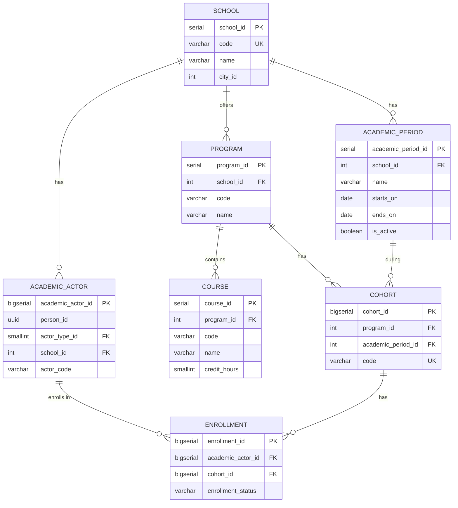

# Domain: Academic

> **Owner:** Academic bounded context
> **DB Engine:** PostgreSQL 17 — ACID transactions, complex relationships, enrollment management
>
> **Engine justification:**
> - Complex relational model with multiple FKs for school-program-cohort-course hierarchy.
> - Unified `academic_actor` replaces separate Student/Teacher tables.

---

## Design Principles

- Academic owns: school, program, academic_period, cohort, course, academic_actor_type, academic_actor, enrollment.
- `person_id` in academic_actor is an external reference to Identity — no cross-context FK.
- `academic_actor` unifies students and instructors under a single table with `actor_type`.

---

## 1. Table: school

**Purpose:** Institutional record of each school in the multi-tenant platform.

```sql
CREATE TABLE school (
  -- Business fields
  school_id     SERIAL      PRIMARY KEY,
  code          VARCHAR     NOT NULL UNIQUE,
  name          VARCHAR     NOT NULL,
  -- External catalog via countriesnow API, no FK (DBML v6/v7: city table removed)
  city_id       VARCHAR     NULL,
  address       VARCHAR,
  district      VARCHAR     NULL,
  country       VARCHAR     NULL,
  city_name     VARCHAR     NULL,
  phone         VARCHAR,
  email         VARCHAR,

  -- Status fields
  status        BOOLEAN     NOT NULL DEFAULT true,

  -- Audit (in all tables)
  created_at    TIMESTAMP NOT NULL DEFAULT NOW(),
  updated_at    TIMESTAMP NOT NULL DEFAULT NOW(),
  deleted_at    TIMESTAMP,
  created_by    UUID,
  updated_by    UUID,
  deleted_by    UUID,
  row_version   BIGINT      NOT NULL DEFAULT 1
);
```

**Data dictionary:**

| Column | Type | Description | Example |
|--------|------|-------------|---------|
| school_id | SERIAL | Auto-incremental school identifier | `1` |
| code | VARCHAR | Unique school code | `ESC-001` |
| name | VARCHAR | Institution name | `Escuela Nacional` |
| city_id | VARCHAR | External city id (countriesnow API, no FK, NULL allowed) | `CO-BOG` |
| address | VARCHAR | Physical address | `Calle 123 #45-67` |
| district | VARCHAR | District/state | `Cundinamarca` |
| country | VARCHAR | Country | `Colombia` |
| city_name | VARCHAR | Denormalized city label from external API | `Bogota` |
| phone | VARCHAR | Contact phone number | `+57 300 123 4567` |
| email | VARCHAR | Institutional email | `info@escuela.edu.co` |
| status | BOOLEAN | Active/inactive flag | `true` |
| created_at | TIMESTAMP | When the record was created | `2024-01-15T10:30:00Z` |
| updated_at | TIMESTAMP | When the record was last updated | `2024-01-15T10:30:00Z` |
| deleted_at | TIMESTAMP | NULL = active; with value = soft-deleted | `NULL` |
| created_by | UUID | User who created this record | `550e8400-...` |
| updated_by | UUID | User who last updated this record | `550e8400-...` |
| deleted_by | UUID | User who soft-deleted this record | `NULL` |
| row_version | BIGINT | Optimistic lock version counter | `1` |

**Modeling decisions:**
1. `school_id` is SERIAL (not UUID) — internal identifier, not exposed cross-context.
2. `code` is the business identifier used in APIs and reports.
3. `city_id` is an external catalog id (VARCHAR NULL, no FK) — `identity.city` is deprecated; cities come from `countriesnow.space`. `district/country/city_name` are display fields from that API.

---

## 2. Table: program

**Purpose:** Academic programs offered by a school (e.g., Engineering, Medicine).

```sql
CREATE TABLE program (
  -- Business fields
  program_id    SERIAL      PRIMARY KEY,
  school_id     INT         NOT NULL,
  code          VARCHAR     NOT NULL,
  name          VARCHAR     NOT NULL,

  -- Status fields
  status        BOOLEAN     NOT NULL DEFAULT true,

  -- Audit (in all tables)
  created_at    TIMESTAMP NOT NULL DEFAULT NOW(),
  updated_at    TIMESTAMP NOT NULL DEFAULT NOW(),
  deleted_at    TIMESTAMP,
  created_by    UUID,
  updated_by    UUID,
  deleted_by    UUID,
  row_version   BIGINT      NOT NULL DEFAULT 1
);

CREATE UNIQUE INDEX uq_program_code_school ON program (school_id, code);
```

**Data dictionary:**

| Column | Type | Description | Example |
|--------|------|-------------|---------|
| program_id | SERIAL | Auto-incremental program identifier | `1` |
| school_id | INT | Owning school (FK → school) | `1` |
| code | VARCHAR | Program code within the school | `ING-SIS` |
| name | VARCHAR | Program name | `Systems Engineering` |
| status | BOOLEAN | Active/inactive flag | `true` |
| created_at | TIMESTAMP | When the record was created | `2024-01-15T10:30:00Z` |
| updated_at | TIMESTAMP | When the record was last updated | `2024-01-15T10:30:00Z` |
| deleted_at | TIMESTAMP | NULL = active; with value = soft-deleted | `NULL` |
| created_by | UUID | User who created this record | `550e8400-...` |
| updated_by | UUID | User who last updated this record | `550e8400-...` |
| deleted_by | UUID | User who soft-deleted this record | `NULL` |
| row_version | BIGINT | Optimistic lock version counter | `1` |

---

## 3. Table: academic_period

**Purpose:** Academic periods (semesters, trimesters).

```sql
CREATE TABLE academic_period (
  -- Business fields
  academic_period_id  SERIAL      PRIMARY KEY,
  school_id           INT         NOT NULL,
  name                VARCHAR     NOT NULL,
  starts_on           DATE        NOT NULL,
  ends_on             DATE        NOT NULL CHECK (ends_on > starts_on),

  -- Status fields
  is_active           BOOLEAN     NOT NULL DEFAULT false,

  -- Audit (in all tables)
  created_at          TIMESTAMP NOT NULL DEFAULT NOW(),
  updated_at          TIMESTAMP NOT NULL DEFAULT NOW(),
  deleted_at          TIMESTAMP,
  created_by          UUID,
  updated_by          UUID,
  deleted_by          UUID,
  row_version         BIGINT      NOT NULL DEFAULT 1,

  CONSTRAINT chk_period_dates CHECK (starts_on < ends_on)
);

CREATE UNIQUE INDEX uq_period_name_school ON academic_period (school_id, name);
```

**Data dictionary:**

| Column | Type | Description | Example |
|--------|------|-------------|---------|
| academic_period_id | SERIAL | Auto-incremental period identifier | `1` |
| school_id | INT | Owning school (FK → school) | `1` |
| name | VARCHAR | Period name | `2026-S1` |
| starts_on | DATE | Period start date | `2026-01-15` |
| ends_on | DATE | Period end date | `2026-06-30` |
| is_active | BOOLEAN | Whether this is the current active period | `true` |
| created_at | TIMESTAMP | When the record was created | `2024-01-15T10:30:00Z` |
| updated_at | TIMESTAMP | When the record was last updated | `2024-01-15T10:30:00Z` |
| deleted_at | TIMESTAMP | NULL = active; with value = soft-deleted | `NULL` |
| created_by | UUID | User who created this record | `550e8400-...` |
| updated_by | UUID | User who last updated this record | `550e8400-...` |
| deleted_by | UUID | User who soft-deleted this record | `NULL` |
| row_version | BIGINT | Optimistic lock version counter | `1` |

---

## 4. Table: cohort

**Purpose:** A group of students enrolled in a program for a specific period.

```sql
CREATE TABLE cohort (
  -- Business fields
  cohort_id           BIGSERIAL   PRIMARY KEY,
  program_id          INT         NOT NULL,
  academic_period_id  INT         NOT NULL,
  code                VARCHAR     NOT NULL UNIQUE,

  -- Status fields
  status              BOOLEAN     NOT NULL DEFAULT true,

  -- Audit (in all tables)
  created_at          TIMESTAMP NOT NULL DEFAULT NOW(),
  updated_at          TIMESTAMP NOT NULL DEFAULT NOW(),
  deleted_at          TIMESTAMP,
  created_by          UUID,
  updated_by          UUID,
  deleted_by          UUID,
  row_version         BIGINT      NOT NULL DEFAULT 1
);
```

**Data dictionary:**

| Column | Type | Description | Example |
|--------|------|-------------|---------|
| cohort_id | BIGSERIAL | Auto-incremental cohort identifier | `1` |
| program_id | INT | Program (FK → program) | `1` |
| academic_period_id | INT | Academic period (FK → academic_period) | `1` |
| code | VARCHAR | Globally unique cohort code | `ING-SIS-2026-S1-01` |
| status | BOOLEAN | Active/inactive flag | `true` |
| created_at | TIMESTAMP | When the record was created | `2024-01-15T10:30:00Z` |
| updated_at | TIMESTAMP | When the record was last updated | `2024-01-15T10:30:00Z` |
| deleted_at | TIMESTAMP | NULL = active; with value = soft-deleted | `NULL` |
| created_by | UUID | User who created this record | `550e8400-...` |
| updated_by | UUID | User who last updated this record | `550e8400-...` |
| deleted_by | UUID | User who soft-deleted this record | `NULL` |
| row_version | BIGINT | Optimistic lock version counter | `1` |

---

## 5. Table: course

**Purpose:** Courses within a program, with credit hours.

```sql
CREATE TABLE course (
  -- Business fields
  course_id     SERIAL      PRIMARY KEY,
  program_id    INT         NOT NULL,
  code          VARCHAR     NOT NULL,
  name          VARCHAR     NOT NULL,
  credit_hours  SMALLINT    NOT NULL,

  -- Status fields
  status        BOOLEAN     NOT NULL DEFAULT true,

  -- Audit (in all tables)
  created_at    TIMESTAMP NOT NULL DEFAULT NOW(),
  updated_at    TIMESTAMP NOT NULL DEFAULT NOW(),
  deleted_at    TIMESTAMP,
  created_by    UUID,
  updated_by    UUID,
  deleted_by    UUID,
  row_version   BIGINT      NOT NULL DEFAULT 1
);

CREATE UNIQUE INDEX uq_course_code_program ON course (program_id, code);
```

**Data dictionary:**

| Column | Type | Description | Example |
|--------|------|-------------|---------|
| course_id | SERIAL | Auto-incremental course identifier | `1` |
| program_id | INT | Owning program (FK → program) | `1` |
| code | VARCHAR | Course code within the program | `MAT-101` |
| name | VARCHAR | Course name | `Calculus I` |
| credit_hours | SMALLINT | Number of credit hours | `4` |
| status | BOOLEAN | Active/inactive flag | `true` |
| created_at | TIMESTAMP | When the record was created | `2024-01-15T10:30:00Z` |
| updated_at | TIMESTAMP | When the record was last updated | `2024-01-15T10:30:00Z` |
| deleted_at | TIMESTAMP | NULL = active; with value = soft-deleted | `NULL` |
| created_by | UUID | User who created this record | `550e8400-...` |
| updated_by | UUID | User who last updated this record | `550e8400-...` |
| deleted_by | UUID | User who soft-deleted this record | `NULL` |
| row_version | BIGINT | Optimistic lock version counter | `1` |

---

## 6. Table: academic_actor_type

**Purpose:** Catalog of academic actor types (STUDENT, INSTRUCTOR).

```sql
CREATE TABLE academic_actor_type (
  -- Business fields
  actor_type_id SMALLINT    PRIMARY KEY,
  code          VARCHAR     NOT NULL UNIQUE,
  name          VARCHAR     NOT NULL,

  -- Audit (in all tables)
  created_at    TIMESTAMP NOT NULL DEFAULT NOW(),
  updated_at    TIMESTAMP NOT NULL DEFAULT NOW(),
  deleted_at    TIMESTAMP,
  created_by    UUID,
  updated_by    UUID,
  deleted_by    UUID,
  row_version   BIGINT      NOT NULL DEFAULT 1
);
```

**Data dictionary:**

| Column | Type | Description | Example |
|--------|------|-------------|---------|
| actor_type_id | SMALLINT | Auto-incremental type identifier | `1` |
| code | VARCHAR | Type code (unique) | `STUDENT` |
| name | VARCHAR | Type name | `Student` |
| created_at | TIMESTAMP | When the record was created | `2024-01-15T10:30:00Z` |
| updated_at | TIMESTAMP | When the record was last updated | `2024-01-15T10:30:00Z` |
| deleted_at | TIMESTAMP | NULL = active; with value = soft-deleted | `NULL` |
| created_by | UUID | User who created this record | `550e8400-...` |
| updated_by | UUID | User who last updated this record | `550e8400-...` |
| deleted_by | UUID | User who soft-deleted this record | `NULL` |
| row_version | BIGINT | Optimistic lock version counter | `1` |

---

## 7. Table: academic_actor

**Purpose:** Unified table for students and instructors. Replaces separate Student/Teacher tables.

```sql
CREATE TABLE academic_actor (
  -- Business fields
  academic_actor_id BIGSERIAL   PRIMARY KEY,
  person_id         UUID        NOT NULL,
  actor_type_id     SMALLINT    NOT NULL,
  school_id         INT         NOT NULL,
  actor_code        VARCHAR     NOT NULL,
  started_on        DATE        NOT NULL,
  ended_on          DATE,

  -- Status fields
  status            BOOLEAN     NOT NULL DEFAULT true,

  -- Audit (in all tables)
  created_at        TIMESTAMP NOT NULL DEFAULT NOW(),
  updated_at        TIMESTAMP NOT NULL DEFAULT NOW(),
  deleted_at        TIMESTAMP,
  created_by        UUID,
  updated_by        UUID,
  deleted_by        UUID,
  row_version       BIGINT      NOT NULL DEFAULT 1
);

CREATE UNIQUE INDEX uq_actor_code_school_type
  ON academic_actor (school_id, actor_type_id, actor_code);
CREATE UNIQUE INDEX uq_actor_person_type_school
  ON academic_actor (person_id, actor_type_id, school_id);
CREATE INDEX idx_actor_deleted ON academic_actor (deleted_at) WHERE deleted_at IS NULL;
```

**Data dictionary:**

| Column | Type | Description | Example |
|--------|------|-------------|---------|
| academic_actor_id | BIGSERIAL | Auto-incremental actor identifier | `1` |
| person_id | UUID | External identity (→ Identity.person) | `550e8400-...` |
| actor_type_id | SMALLINT | Actor type (FK → academic_actor_type) | `1` |
| school_id | INT | School (FK → school) | `1` |
| actor_code | VARCHAR | Institutional code for this actor | `EST-2024-001` |
| started_on | DATE | When the actor started in this role | `2024-01-15` |
| ended_on | DATE | When the actor ended this role (NULL = active) | `NULL` |
| status | BOOLEAN | Active/inactive flag | `true` |
| created_at | TIMESTAMP | When the record was created | `2024-01-15T10:30:00Z` |
| updated_at | TIMESTAMP | When the record was last updated | `2024-01-15T10:30:00Z` |
| deleted_at | TIMESTAMP | NULL = active; with value = soft-deleted | `NULL` |
| created_by | UUID | User who created this record | `550e8400-...` |
| updated_by | UUID | User who last updated this record | `550e8400-...` |
| deleted_by | UUID | User who soft-deleted this record | `NULL` |
| row_version | BIGINT | Optimistic lock version counter | `1` |

**Modeling decisions:**
1. Unified table: a person can be both student and instructor (different `actor_type_id`).
2. `person_id` is an external reference to Identity — no cross-context FK.
3. Two unique constraints: code per school+type, and person per type+school.

---

## 8. Table: enrollment

**Purpose:** Enrollment of an academic_actor in a cohort.

```sql
-- Native ENUM: CREATE TYPE academic.enrollment_status AS ENUM ('Active','Withdrawn','Completed');
CREATE TABLE enrollment (
  -- Business fields
  enrollment_id       BIGSERIAL   PRIMARY KEY,
  academic_actor_id   BIGINT      NOT NULL,
  cohort_id           BIGINT      NOT NULL,
  enrolled_on         DATE        NOT NULL,

  -- Status fields
  enrollment_status   academic.enrollment_status NOT NULL,

  -- Audit (in all tables)
  created_at          TIMESTAMP NOT NULL DEFAULT NOW(),
  updated_at          TIMESTAMP NOT NULL DEFAULT NOW(),
  deleted_at          TIMESTAMP,
  created_by          UUID,
  updated_by          UUID,
  deleted_by          UUID,
  row_version         BIGINT      NOT NULL DEFAULT 1
);

CREATE UNIQUE INDEX uq_enrollment_actor_cohort
  ON enrollment (academic_actor_id, cohort_id);
CREATE INDEX idx_enrollment_cohort ON enrollment (cohort_id);
CREATE INDEX idx_enrollment_deleted ON enrollment (deleted_at) WHERE deleted_at IS NULL;
```

**Data dictionary:**

| Column | Type | Description | Example |
|--------|------|-------------|---------|
| enrollment_id | BIGSERIAL | Auto-incremental enrollment identifier | `1` |
| academic_actor_id | BIGINT | Enrolled actor (FK → academic_actor) | `1` |
| cohort_id | BIGINT | Target cohort (FK → cohort) | `1` |
| enrolled_on | DATE | Enrollment date | `2024-01-15` |
| enrollment_status | VARCHAR | Status: Active, Withdrawn, Completed | `Active` |
| created_at | TIMESTAMP | When the record was created | `2024-01-15T10:30:00Z` |
| updated_at | TIMESTAMP | When the record was last updated | `2024-01-15T10:30:00Z` |
| deleted_at | TIMESTAMP | NULL = active; with value = soft-deleted | `NULL` |
| created_by | UUID | User who created this record | `550e8400-...` |
| updated_by | UUID | User who last updated this record | `550e8400-...` |
| deleted_by | UUID | User who soft-deleted this record | `NULL` |
| row_version | BIGINT | Optimistic lock version counter | `1` |

---

## 9. Relationship Diagram



---

## 10. Cross-Context Relationships

| From | To | Reference Type | Mechanism |
|------|----|----------------|-----------|
| School.city_id | External countriesnow API | External catalog (no FK) | VARCHAR NULL display id + city_name/district/country |
| Academic_Actor.person_id | Identity.Person.person_id | External ID (no FK) | Cross-context reference by UUID |
| Scheduling.Schedule_Block.cohort_id | Academic.Cohort.cohort_id | External ID (no FK) | Cross-context reference by BIGINT |
| Scheduling.Schedule_Block.course_id | Academic.Course.course_id | External ID (no FK) | Cross-context reference by SERIAL |
| Scheduling.Class_Session.opened_by | Academic.Academic_Actor.academic_actor_id | External ID (no FK) | Cross-context reference by BIGINT |
| Attendance.Attendance_Record.academic_actor_id | Academic.Academic_Actor.academic_actor_id | External ID (no FK) | Cross-context reference by BIGINT |

---

## 11. Correlations

- Domain entities that map to these tables → `02-domain/entities-and-rules.md`
- Saga and Outbox pattern for distributed consistency → `05-architecture/pattern-guide.md`
- Data for each service in detail → `09-microservices/services/academic-service/data-model.md`
- How data is accessed via API → `07-api/contracts/openapi/`
