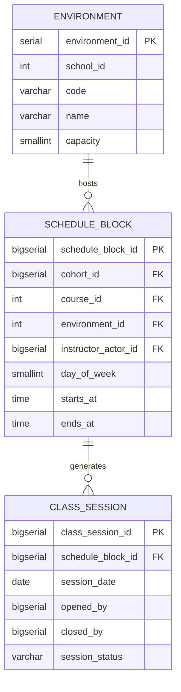

# Domain: Scheduling

> **Owner:** Scheduling bounded context
> **DB Engine:** PostgreSQL 17 — ACID transactions, conflict prevention for room/instructor booking
>
> **Engine justification:**
> - Unique constraints on (environment, day, time) and (instructor, day, time) prevent double-booking.
> - Separated from Academic to allow independent evolution of timetable management.

---

## Design Principles

- Scheduling owns: environment, schedule_block, class_session.
- `cohort_id`, `course_id`, `instructor_actor_id` are external references to Academic — no cross-context FKs.
- `environment.school_id` is an external reference to Academic.school.

---

## 1. Table: environment

**Purpose:** Physical spaces where classes are held (classrooms, labs, auditoriums).

```sql
CREATE TABLE environment (
  -- Business fields
  environment_id  SERIAL      PRIMARY KEY,
  school_id       INT         NOT NULL,
  code            VARCHAR     NOT NULL,
  name            VARCHAR     NOT NULL,
  capacity        SMALLINT    NOT NULL,

  -- Status fields
  status          BOOLEAN     NOT NULL DEFAULT true,

  -- Audit (in all tables)
  created_at      TIMESTAMP NOT NULL DEFAULT NOW(),
  updated_at      TIMESTAMP NOT NULL DEFAULT NOW(),
  deleted_at      TIMESTAMP,
  created_by      UUID,
  updated_by      UUID,
  deleted_by      UUID,
  row_version     BIGINT      NOT NULL DEFAULT 1
);

CREATE UNIQUE INDEX uq_environment_code_school ON environment (school_id, code);
```

**Data dictionary:**

| Column | Type | Description | Example |
|--------|------|-------------|---------|
| environment_id | SERIAL | Auto-incremental environment identifier | `1` |
| school_id | INT | Owning school (external ID → Academic.school) | `1` |
| code | VARCHAR | Environment code within the school | `SAL-101` |
| name | VARCHAR | Environment name | `Room 101` |
| capacity | SMALLINT | Maximum occupancy | `30` |
| status | BOOLEAN | Active/inactive flag | `true` |
| created_at | TIMESTAMP | When the record was created | `2024-01-15T10:30:00Z` |
| updated_at | TIMESTAMP | When the record was last updated | `2024-01-15T10:30:00Z` |
| deleted_at | TIMESTAMP | NULL = active; with value = soft-deleted | `NULL` |
| created_by | UUID | User who created this record | `550e8400-...` |
| updated_by | UUID | User who last updated this record | `550e8400-...` |
| deleted_by | UUID | User who soft-deleted this record | `NULL` |
| row_version | BIGINT | Optimistic lock version counter | `1` |

---

## 2. Table: schedule_block

**Purpose:** A recurring time slot in the timetable (e.g., "Calculus I, Mondays 8:00-9:30, Room 101").

```sql
CREATE TABLE schedule_block (
  -- Business fields
  schedule_block_id   BIGSERIAL   PRIMARY KEY,
  cohort_id           BIGINT      NOT NULL,
  course_id           INT         NOT NULL,
  environment_id      INT         NOT NULL,
  instructor_actor_id BIGINT      NOT NULL,
  day_of_week         SMALLINT    NOT NULL CHECK (day_of_week BETWEEN 1 AND 7),
  starts_at           TIME        NOT NULL,
  ends_at             TIME        NOT NULL CHECK (ends_at > starts_at),

  -- Audit (in all tables)
  created_at          TIMESTAMP NOT NULL DEFAULT NOW(),
  updated_at          TIMESTAMP NOT NULL DEFAULT NOW(),
  deleted_at          TIMESTAMP,
  created_by          UUID,
  updated_by          UUID,
  deleted_by          UUID,
  row_version         BIGINT      NOT NULL DEFAULT 1,

  CONSTRAINT chk_block_day_of_week CHECK (day_of_week BETWEEN 1 AND 7),
  CONSTRAINT chk_block_time CHECK (starts_at < ends_at)
);

CREATE UNIQUE INDEX uq_block_environment_slot
  ON schedule_block (environment_id, day_of_week, starts_at);
CREATE UNIQUE INDEX uq_block_instructor_slot
  ON schedule_block (instructor_actor_id, day_of_week, starts_at);
CREATE INDEX idx_block_cohort ON schedule_block (cohort_id);
CREATE INDEX idx_block_course ON schedule_block (course_id);
```

**Data dictionary:**

| Column | Type | Description | Example |
|--------|------|-------------|---------|
| schedule_block_id | BIGSERIAL | Auto-incremental block identifier | `1` |
| cohort_id | BIGINT | Target cohort (external ID → Academic.cohort) | `1` |
| course_id | INT | Course being taught (external ID → Academic.course) | `1` |
| environment_id | INT | Classroom (FK → environment) | `1` |
| instructor_actor_id | BIGINT | Instructor (external ID → Academic.academic_actor) | `1` |
| day_of_week | SMALLINT | Day of week (1..7) | `1` |
| starts_at | TIME | Block start time | `08:00` |
| ends_at | TIME | Block end time | `09:30` |
| created_at | TIMESTAMP | When the record was created | `2024-01-15T10:30:00Z` |
| updated_at | TIMESTAMP | When the record was last updated | `2024-01-15T10:30:00Z` |
| deleted_at | TIMESTAMP | NULL = active; with value = soft-deleted | `NULL` |
| created_by | UUID | User who created this record | `550e8400-...` |
| updated_by | UUID | User who last updated this record | `550e8400-...` |
| deleted_by | UUID | User who soft-deleted this record | `NULL` |
| row_version | BIGINT | Optimistic lock version counter | `1` |

**Modeling decisions:**
1. Two unique constraints prevent double-booking: same room at same time, or same instructor at same time.
2. `day_of_week` is SMALLINT 1..7 ISO with `chk_block_day_of_week`; `starts_at < ends_at` with `chk_block_time`.
3. `cohort_id`, `course_id`, `instructor_actor_id` are external references — no cross-context FKs.

---

## 3. Table: class_session

**Purpose:** A real occurrence of a schedule_block on a specific date. Opened/closed by the instructor.

```sql
-- Native ENUM: CREATE TYPE scheduling.class_session_status AS ENUM ('Open','Closed','Cancelled');
CREATE TABLE class_session (
  -- Business fields
  class_session_id  BIGSERIAL   PRIMARY KEY,
  schedule_block_id BIGINT      NOT NULL,
  session_date      DATE        NOT NULL,
  opened_by         BIGINT,
  opened_at         TIMESTAMP,
  closed_by         BIGINT,
  closed_at         TIMESTAMP,

  -- Status fields
  session_status    scheduling.class_session_status NOT NULL,

  -- Audit (in all tables)
  created_at        TIMESTAMP NOT NULL DEFAULT NOW(),
  updated_at        TIMESTAMP NOT NULL DEFAULT NOW(),
  deleted_at        TIMESTAMP,
  created_by        UUID,
  updated_by        UUID,
  deleted_by        UUID,
  row_version       BIGINT      NOT NULL DEFAULT 1
);

CREATE UNIQUE INDEX uq_session_block_date ON class_session (schedule_block_id, session_date);
CREATE INDEX idx_session_date ON class_session (session_date);
```

**Data dictionary:**

| Column | Type | Description | Example |
|--------|------|-------------|---------|
| class_session_id | BIGSERIAL | Auto-incremental session identifier | `1` |
| schedule_block_id | BIGINT | Parent schedule block (FK → schedule_block) | `1` |
| session_date | DATE | Date of this session | `2024-06-01` |
| opened_by | BIGINT | Instructor who opened the class (external ID → Academic.academic_actor) | `1` |
| opened_at | TIMESTAMP | When the instructor opened the class | `2024-06-01T08:00:00Z` |
| closed_by | BIGINT | Instructor who closed the class (external ID) | `1` |
| closed_at | TIMESTAMP | When the instructor closed the class | `2024-06-01T09:30:00Z` |
| session_status | VARCHAR | State: Open, Closed, Cancelled | `Open` |
| created_at | TIMESTAMP | When the record was created | `2024-06-01T08:00:00Z` |
| updated_at | TIMESTAMP | When the record was last updated | `2024-06-01T08:00:00Z` |
| deleted_at | TIMESTAMP | NULL = active; with value = soft-deleted | `NULL` |
| created_by | UUID | User who created this record | `550e8400-...` |
| updated_by | UUID | User who last updated this record | `550e8400-...` |
| deleted_by | UUID | User who soft-deleted this record | `NULL` |
| row_version | BIGINT | Optimistic lock version counter | `1` |

**Modeling decisions:**
1. One session per block per date — no duplicates.
2. `opened_by`/`closed_by` can differ from the scheduled instructor (substitution).
3. Sessions are created on-demand when the instructor starts class.

---

## 4. Relationship Diagram



---

## 5. Cross-Context Relationships

| From | To | Reference Type | Mechanism |
|------|----|----------------|-----------|
| Environment.school_id | Academic.School.school_id | External ID (no FK) | Cross-context reference by SERIAL |
| Schedule_Block.cohort_id | Academic.Cohort.cohort_id | External ID (no FK) | Cross-context reference by BIGINT |
| Schedule_Block.course_id | Academic.Course.course_id | External ID (no FK) | Cross-context reference by SERIAL |
| Schedule_Block.instructor_actor_id | Academic.Academic_Actor.academic_actor_id | External ID (no FK) | Cross-context reference by BIGINT |
| Class_Session.opened_by | Academic.Academic_Actor.academic_actor_id | External ID (no FK) | Cross-context reference by BIGINT |
| Class_Session.closed_by | Academic.Academic_Actor.academic_actor_id | External ID (no FK) | Cross-context reference by BIGINT |
| Attendance.Attendance_Record.class_session_id | Scheduling.Class_Session.class_session_id | External ID (no FK) | Cross-context reference by BIGINT |

---

## 6. Correlations

- Domain entities that map to these tables → `02-domain/entities-and-rules.md`
- Saga and Outbox pattern for distributed consistency → `05-architecture/pattern-guide.md`
- Data for each service in detail → `09-microservices/services/scheduling-service/data-model.md`
- How data is accessed via API → `07-api/contracts/openapi/`
