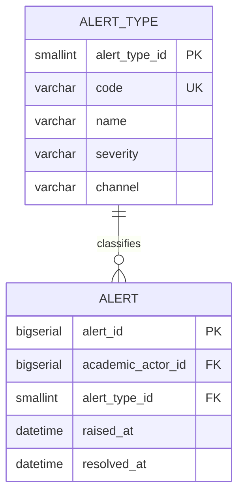

# Domain: Notification

> **Owner:** Notification bounded context
> **DB Engine:** PostgreSQL 17 — ACID transactions, alert lifecycle management
>
> **Engine justification:**
> - Alerts require reliable state tracking (raised → resolved).
> - Alert types are catalog-driven for extensibility.

---

## Design Principles

- Notification owns: alert_type, alert.
- `academic_actor_id` is an external reference to Academic — no cross-context FK.

---

## 1. Table: alert_type

**Purpose:** Catalog of alert types (e.g., absence threshold reached, schedule conflict).

```sql
CREATE TABLE alert_type (
  -- Business fields
  alert_type_id SMALLINT    PRIMARY KEY,
  code          VARCHAR     NOT NULL UNIQUE,
  name          VARCHAR     NOT NULL,
  severity      VARCHAR     NOT NULL CHECK (severity IN ('INFO','WARNING','CRITICAL')),
  channel       VARCHAR     NOT NULL DEFAULT 'DASHBOARD' CHECK (channel IN ('DASHBOARD','EMAIL','PUSH')),

  -- Audit (in all tables)
  created_at    TIMESTAMP NOT NULL DEFAULT NOW(),
  updated_at    TIMESTAMP NOT NULL DEFAULT NOW(),
  deleted_at    TIMESTAMP,
  created_by    UUID,
  updated_by    UUID,
  deleted_by    UUID,
  row_version   BIGINT      NOT NULL DEFAULT 1
);
```

**Data dictionary:**

| Column | Type | Description | Example |
|--------|------|-------------|---------|
| alert_type_id | SMALLINT | Auto-incremental type identifier | `1` |
| code | VARCHAR | Unique type code | `ABSENCE_THRESHOLD` |
| name | VARCHAR | Type name | `Absence threshold reached` |
| severity | VARCHAR | INFO / WARNING / CRITICAL | `WARNING` |
| channel | VARCHAR | DASHBOARD / EMAIL / PUSH | `DASHBOARD` |
| created_at | TIMESTAMP | When the record was created | `2024-01-15T10:30:00Z` |
| updated_at | TIMESTAMP | When the record was last updated | `2024-01-15T10:30:00Z` |
| deleted_at | TIMESTAMP | NULL = active; with value = soft-deleted | `NULL` |
| created_by | UUID | User who created this record | `550e8400-...` |
| updated_by | UUID | User who last updated this record | `550e8400-...` |
| deleted_by | UUID | User who soft-deleted this record | `NULL` |
| row_version | BIGINT | Optimistic lock version counter | `1` |

---

## 2. Table: alert

**Purpose:** An alert raised for an academic_actor.

```sql
CREATE TABLE alert (
  -- Business fields
  alert_id          BIGSERIAL   PRIMARY KEY,
  academic_actor_id BIGINT      NOT NULL,
  alert_type_id     SMALLINT    NOT NULL,
  raised_at         TIMESTAMP NOT NULL,
  resolved_at       TIMESTAMP,

  -- Audit (in all tables)
  created_at        TIMESTAMP NOT NULL DEFAULT NOW(),
  updated_at        TIMESTAMP NOT NULL DEFAULT NOW(),
  deleted_at        TIMESTAMP,
  created_by        UUID,
  updated_by        UUID,
  deleted_by        UUID,
  row_version       BIGINT      NOT NULL DEFAULT 1
);

CREATE INDEX idx_alert_actor ON alert (academic_actor_id);
CREATE INDEX idx_alert_type ON alert (alert_type_id);
```

**Data dictionary:**

| Column | Type | Description | Example |
|--------|------|-------------|---------|
| alert_id | BIGSERIAL | Auto-incremental alert identifier | `1` |
| academic_actor_id | BIGINT | Actor this alert is about (external ID → Academic.academic_actor) | `1` |
| alert_type_id | SMALLINT | Alert type (FK → alert_type) | `1` |
| raised_at | TIMESTAMP | When the alert was raised | `2024-06-01T10:00:00Z` |
| resolved_at | TIMESTAMP | When the alert was resolved (NULL = unresolved) | `NULL` |
| created_at | TIMESTAMP | When the record was created | `2024-06-01T10:00:00Z` |
| updated_at | TIMESTAMP | When the record was last updated | `2024-06-01T10:00:00Z` |
| deleted_at | TIMESTAMP | NULL = active; with value = soft-deleted | `NULL` |
| created_by | UUID | User who created this record | `550e8400-...` |
| updated_by | UUID | User who last updated this record | `550e8400-...` |
| deleted_by | UUID | User who soft-deleted this record | `NULL` |
| row_version | BIGINT | Optimistic lock version counter | `1` |

---

## 3. Relationship Diagram



---

## 4. Cross-Context Relationships

| From | To | Reference Type | Mechanism |
|------|----|----------------|-----------|
| Alert.academic_actor_id | Academic.Academic_Actor.academic_actor_id | External ID (no FK) | Cross-context reference by BIGINT |

---

## 5. Correlations

- Domain entities that map to these tables → `02-domain/entities-and-rules.md`
- Saga and Outbox pattern for distributed consistency → `05-architecture/pattern-guide.md`
- Data for each service in detail → `09-microservices/services/notification-service/data-model.md`
- How data is accessed via API → `07-api/contracts/openapi/`
