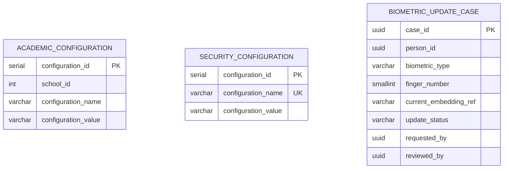

# Domain: Configuration

> **Owner:** Configuration bounded context
> **DB Engine:** PostgreSQL 17 — key-value configuration storage with relational structure
>
> **Engine justification:**
> - Configuration parameters require ACID transactions for safe updates.
> - `biometric_update_case` requires relational state tracking (Pending/Approved/Rejected).

---

## Design Principles

- Configuration is cross-cutting — it does not directly relate to User/Person.
- `biometric_update_case` is the unified table for both facial and fingerprint update requests.
- **Logical owner is Biometric (DBML v7):** this schema hosts it only transiently for Liquibase/service compatibility. See `06-biometric.md`.

---

## 1. Table: academic_configuration

**Purpose:** Configurable parameters per school that affect academic behavior.

```sql
CREATE TABLE academic_configuration (
  -- Business fields
  configuration_id    SERIAL      PRIMARY KEY,
  school_id           INT         NOT NULL,
  configuration_name  VARCHAR     NOT NULL,
  configuration_value VARCHAR     NOT NULL,
  description         VARCHAR,

  -- Audit (in all tables)
  created_at          TIMESTAMP NOT NULL DEFAULT NOW(),
  updated_at          TIMESTAMP NOT NULL DEFAULT NOW(),
  deleted_at          TIMESTAMP,
  created_by          UUID,
  updated_by          UUID,
  deleted_by          UUID,
  row_version         BIGINT      NOT NULL DEFAULT 1
);

CREATE UNIQUE INDEX uq_academic_configuration
  ON academic_configuration (school_id, configuration_name);
```

**Data dictionary:**

| Column | Type | Description | Example |
|--------|------|-------------|---------|
| configuration_id | SERIAL | Auto-incremental configuration identifier | `1` |
| school_id | INT | Owning school (external ID → Academic.school) | `1` |
| configuration_name | VARCHAR | Parameter name | `tardy_tolerance_minutes` |
| configuration_value | VARCHAR | Parameter value (stored as string) | `15` |
| description | VARCHAR | Parameter description | `Minutes after start before marking late` |
| created_at | TIMESTAMP | When the record was created | `2024-01-15T10:30:00Z` |
| updated_at | TIMESTAMP | When the record was last updated | `2024-01-15T10:30:00Z` |
| deleted_at | TIMESTAMP | NULL = active; with value = soft-deleted | `NULL` |
| created_by | UUID | User who created this record | `550e8400-...` |
| updated_by | UUID | User who last updated this record | `550e8400-...` |
| deleted_by | UUID | User who soft-deleted this record | `NULL` |
| row_version | BIGINT | Optimistic lock version counter | `1` |

---

## 2. Table: security_configuration

**Purpose:** System-wide security configuration parameters (not per-school).

```sql
CREATE TABLE security_configuration (
  -- Business fields
  configuration_id    SERIAL      PRIMARY KEY,
  configuration_name  VARCHAR     NOT NULL UNIQUE,
  configuration_value VARCHAR     NOT NULL,
  description         VARCHAR,

  -- Audit (in all tables)
  created_at          TIMESTAMP NOT NULL DEFAULT NOW(),
  updated_at          TIMESTAMP NOT NULL DEFAULT NOW(),
  deleted_at          TIMESTAMP,
  created_by          UUID,
  updated_by          UUID,
  deleted_by          UUID,
  row_version         BIGINT      NOT NULL DEFAULT 1
);
```

**Data dictionary:**

| Column | Type | Description | Example |
|--------|------|-------------|---------|
| configuration_id | SERIAL | Auto-incremental configuration identifier | `1` |
| configuration_name | VARCHAR | Unique parameter name | `max_login_attempts` |
| configuration_value | VARCHAR | Parameter value | `5` |
| description | VARCHAR | Parameter description | `Max failed logins before lockout` |
| created_at | TIMESTAMP | When the record was created | `2024-01-15T10:30:00Z` |
| updated_at | TIMESTAMP | When the record was last updated | `2024-01-15T10:30:00Z` |
| deleted_at | TIMESTAMP | NULL = active; with value = soft-deleted | `NULL` |
| created_by | UUID | User who created this record | `550e8400-...` |
| updated_by | UUID | User who last updated this record | `550e8400-...` |
| deleted_by | UUID | User who soft-deleted this record | `NULL` |
| row_version | BIGINT | Optimistic lock version counter | `1` |

---

## 3. Table: biometric_update_case — logical owner Biometric, physical host Configuration (transient)

**Purpose:** Unified cases for requesting facial or fingerprint embedding updates.

```sql
-- Native ENUMs (logical owner Biometric):
-- CREATE TYPE biometric.biometric_type AS ENUM ('FACIAL','FINGERPRINT');
-- CREATE TYPE biometric.update_status AS ENUM ('Pending','In_Review','Approved','Rejected');
CREATE TABLE biometric_update_case (
  -- Business fields
  case_id                 UUID        PRIMARY KEY,
  person_id               UUID        NOT NULL,
  biometric_type          biometric.biometric_type NOT NULL,
  finger_number           SMALLINT    NULL CHECK (finger_number BETWEEN 1 AND 10),
  current_embedding_ref   VARCHAR,
  reason                  TEXT        NOT NULL,

  -- Status fields
  update_status           biometric.update_status NOT NULL DEFAULT 'Pending',

  -- Audit (in all tables)
  created_at              TIMESTAMP NOT NULL DEFAULT NOW(),
  updated_at              TIMESTAMP NOT NULL DEFAULT NOW(),
  deleted_at              TIMESTAMP,
  created_by              UUID,
  updated_by              UUID,
  deleted_by              UUID,
  row_version             BIGINT      NOT NULL DEFAULT 1,

  -- Workflow
  requested_by            UUID        NOT NULL,
  requested_at            TIMESTAMP NOT NULL,
  reviewed_by             UUID,
  reviewed_at             TIMESTAMP,
  resolution_notes        TEXT,

  CONSTRAINT chk_finger_number CHECK (
    (biometric_type = 'FINGERPRINT' AND finger_number BETWEEN 1 AND 10)
    OR (biometric_type = 'FACIAL' AND finger_number IS NULL)
  )
);

CREATE INDEX idx_biometric_case_person ON biometric_update_case (person_id);
CREATE INDEX idx_biometric_case_person_type ON biometric_update_case (person_id, biometric_type);
CREATE INDEX idx_biometric_case_status ON biometric_update_case (update_status);
```

**Data dictionary:**

| Column | Type | Description | Example |
|--------|------|-------------|---------|
| case_id | UUID | Auto-generated unique case identifier | `550e8400-...` |
| person_id | UUID | Person (external ID → Identity.person) | `550e8400-...` |
| biometric_type | ENUM | FACIAL or FINGERPRINT | `FACIAL` |
| finger_number | SMALLINT | Finger ID (1..10), only if FINGERPRINT, else NULL | `1` |
| current_embedding_ref | VARCHAR | Logical _id in MongoDB (cross-paradigm, no FK) | `507f1f77bcf86cd799439011` |
| reason | TEXT | Reason for the update request | `Significant weight change` |
| update_status | ENUM | Status: Pending, In_Review, Approved, Rejected | `Pending` |
| created_at | TIMESTAMP | When the record was created | `2024-06-01T10:00:00Z` |
| updated_at | TIMESTAMP | When the record was last updated | `2024-06-01T10:00:00Z` |
| deleted_at | TIMESTAMP | NULL = active; with value = soft-deleted | `NULL` |
| created_by | UUID | User who created this record | `550e8400-...` |
| updated_by | UUID | User who last updated this record | `550e8400-...` |
| deleted_by | UUID | User who soft-deleted this record | `NULL` |
| row_version | BIGINT | Optimistic lock version counter | `1` |
| requested_by | UUID | Requesting user, mandatory (external ID → Identity.app_user) | `550e8400-...` |
| requested_at | TIMESTAMP | When the request was submitted, mandatory | `2024-06-01T10:00:00Z` |
| reviewed_by | UUID | Reviewing user (external ID → Identity.app_user) | `550e8400-...` |
| reviewed_at | TIMESTAMP | When the request was reviewed | `2024-06-02T14:00:00Z` |
| resolution_notes | TEXT | Notes from the review | `Approved — new photo captured` |

**Modeling decisions:**
1. Unified table: `biometric_type` distinguishes FACIAL vs FINGERPRINT cases.
2. `finger_number` is only populated when `biometric_type = FINGERPRINT` (`chk_finger_number`).
3. `current_embedding_ref` is a logical reference to the MongoDB document (cross-paradigm).
4. State flow: Pending → In_Review → Approved/Rejected. `requested_by/requested_at` are mandatory.

---

## 4. Relationship Diagram



---

## 5. Cross-Context Relationships

| From | To | Reference Type | Mechanism |
|------|----|----------------|-----------|
| Academic_Configuration.school_id | Academic.School.school_id | External ID (no FK) | Cross-context reference by SERIAL |
| Biometric_Update_Case.person_id | Identity.Person.person_id | External ID (no FK) | Cross-context reference by UUID |
| Biometric_Update_Case.current_embedding_ref | Biometric.Facial/Fingerprint_Embedding._id | External ID (no FK) | Cross-paradigm reference (SQL → NoSQL) |
| Biometric_Update_Case.requested_by | Identity.App_User.user_id | External ID (no FK) | Cross-context reference by UUID |
| Biometric_Update_Case.reviewed_by | Identity.App_User.user_id | External ID (no FK) | Cross-context reference by UUID |

---

## 6. Correlations

- Domain entities that map to these tables → `02-domain/entities-and-rules.md`
- Saga and Outbox pattern for distributed consistency → `05-architecture/pattern-guide.md`
- Data for each service in detail → `09-microservices/services/configuration-service/data-model.md`
- How data is accessed via API → `07-api/contracts/openapi/`
