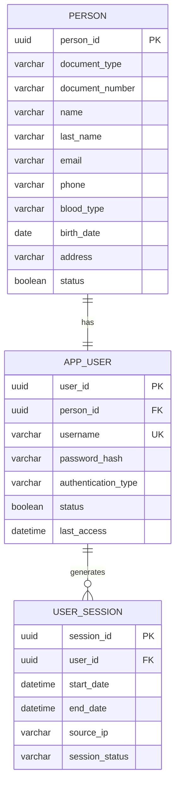

# Dominio: Identity

> **Propietario:** Contexto delimitado Identity
> **Motor de BD:** PostgreSQL 17 — transacciones ACID, integridad relacional, aislamiento multitenant
>
> **Justificación del motor:**
> - Garantías relacionales sólidas para las relaciones persona-usuario.
> - Claves primarias UUID para generación distribuida de identificadores entre microservicios.
> - TIMESTAMP (sin zona horaria) para los campos de auditoría, poblados por `fn_audit_timestamps()`.
> - Bloqueo optimista mediante `row_version` para seguridad ante actualizaciones concurrentes.

---

## 1. Tabla: city — DEPRECATED (legado, aún desplegado)

> **Obsoleta:** `identity.city` fue eliminada del modelo relacional — las ciudades provienen de la
> API externa `countriesnow.space` (ver `academic.school.city_id`). La tabla aún es creada
> por `01-ms-identity-db/01-ddl/03-tables/001-create-city-table.yaml` y Kong aún enruta
> `GET/POST/PUT/DELETE /api/v1/cities` hacia `ms-identity` (marcado como `deprecated: true` en
> `07-api/contracts/openapi/01-identity-service.yaml`). Trátela como legado de solo lectura pendiente
> de eliminación; no construya nuevas funcionalidades sobre ella. `academic.school.city_id` es `VARCHAR NULL` sin
> FK (ver `03-academic.md`).

---

## 2. Tabla: person

**Propósito:** Registro genérico de cualquier persona del sistema (estudiante, instructor, administrador, etc.).

```sql
CREATE TABLE person (
  -- Business fields
  person_id         UUID        PRIMARY KEY DEFAULT gen_random_uuid(),
  document_number   VARCHAR     NOT NULL,
  name              VARCHAR     NOT NULL,
  last_name         VARCHAR     NOT NULL,
  email             VARCHAR,
  phone             VARCHAR,
  document_type     VARCHAR     NULL CHECK (document_type IN ('CC','TI','CE','PP')),
  blood_type        VARCHAR     NULL CHECK (blood_type IN ('A+','A-','B+','B-','AB+','AB-','O+','O-')),
  birth_date        DATE        NULL,
  address           VARCHAR     NULL,

  -- Status fields
  status            BOOLEAN     NOT NULL DEFAULT true,

  -- Audit (in all tables)
  created_at        TIMESTAMP NOT NULL DEFAULT NOW(),
  updated_at        TIMESTAMP NOT NULL DEFAULT NOW(),
  deleted_at        TIMESTAMP,
  created_by        UUID,
  updated_by        UUID,
  deleted_by        UUID,
  row_version       BIGINT      NOT NULL DEFAULT 1
);

-- Real uniqueness is the pair (document_type, document_number):
-- CC and TI may share numbering across different persons.
CREATE UNIQUE INDEX uq_person_document ON person (document_type, document_number);
-- Partial UNIQUE (deployed as id-008-person-email-unique-index): login resolves an email to
-- one app_user; NULLs allowed and a soft-deleted person frees its email for reuse.
CREATE UNIQUE INDEX uq_person_email ON person (email) WHERE deleted_at IS NULL;
CREATE INDEX idx_person_deleted ON person (deleted_at) WHERE deleted_at IS NULL;
```

**Diccionario de datos:**

| Columna | Tipo | Descripción | Ejemplo |
|--------|------|-------------|---------|
| person_id | UUID | Identificador único autogenerado | `550e8400-e29b-41d4-a716-446655440001` |
| document_number | VARCHAR | Número de documento / identificación nacional (único junto con document_type) | `1234567890` |
| name | VARCHAR | Nombre(s) | `Juan` |
| last_name | VARCHAR | Apellido(s) | `Perez` |
| email | VARCHAR | Dirección de correo electrónico | `juan@example.com` |
| phone | VARCHAR | Número de teléfono | `+57 300 987 6543` |
| document_type | VARCHAR | Tipo de documento CHECK: CC/TI/CE/PP | `CC` |
| blood_type | VARCHAR | Tipo de sangre CHECK: A+/A-/B+/B-/AB+/AB-/O+/O- | `O+` |
| birth_date | DATE | Fecha de nacimiento | `2000-05-10` |
| address | VARCHAR | Dirección de residencia | `Calle 123 #45-67` |
| status | BOOLEAN | Indicador de activo/inactivo | `true` |
| created_at | TIMESTAMP | Cuándo se creó el registro | `2024-01-15T10:30:00Z` |
| updated_at | TIMESTAMP | Cuándo se actualizó el registro por última vez | `2024-01-15T10:30:00Z` |
| deleted_at | TIMESTAMP | NULL = activo; con valor = eliminado lógicamente | `NULL` |
| created_by | UUID | Usuario que creó este registro | `550e8400-...` |
| updated_by | UUID | Usuario que actualizó este registro por última vez | `550e8400-...` |
| deleted_by | UUID | Usuario que eliminó lógicamente este registro | `NULL` |
| row_version | BIGINT | Contador de versión para bloqueo optimista | `1` |

**Decisiones de modelado:**
1. La unicidad real es el par `(document_type, document_number)` — CC y TI pueden compartir numeración entre personas distintas.
2. Sin `school_id` — la identidad es agnóstica de sede; una persona puede existir en múltiples sedes vía `academic_actor`.
3. Eliminación lógica vía `deleted_at` que preserva el historial; `deleted_by` registra quién lo eliminó.
4. `document_type` / `blood_type` son VARCHAR + CHECK (no ENUM nativo). `authentication_type` y `session_status` son ENUM nativos de PostgreSQL (el DBML los documenta como `varchar + note`).

---

## 3. Tabla: app_user

**Propósito:** Credenciales de acceso y registro de autenticación. Vinculado 1:1 con Person.

```sql
-- Native ENUM: CREATE TYPE identity.authentication_type AS ENUM ('Local','Windows','External');
CREATE TABLE app_user (
  -- Business fields
  user_id             UUID        PRIMARY KEY DEFAULT gen_random_uuid(),
  person_id           UUID        NOT NULL UNIQUE,
  username            VARCHAR     NOT NULL,
  password_hash       VARCHAR     NOT NULL,
  authentication_type identity.authentication_type NOT NULL,
  status              BOOLEAN     NOT NULL DEFAULT true,
  last_access         TIMESTAMP,

  -- Audit (in all tables)
  created_at          TIMESTAMP NOT NULL DEFAULT NOW(),
  updated_at          TIMESTAMP NOT NULL DEFAULT NOW(),
  deleted_at          TIMESTAMP,
  created_by          UUID,
  updated_by          UUID,
  deleted_by          UUID,
  row_version         BIGINT      NOT NULL DEFAULT 1
);

CREATE UNIQUE INDEX uq_user_username ON app_user (username);
```

**Diccionario de datos:**

| Columna | Tipo | Descripción | Ejemplo |
|--------|------|-------------|---------|
| user_id | UUID | Identificador único autogenerado | `550e8400-e29b-41d4-a716-446655440002` |
| person_id | UUID | Persona vinculada (1:1, FK → person) | `550e8400-...` |
| username | VARCHAR | Nombre de usuario de acceso, globalmente único | `jperez` |
| password_hash | VARCHAR | Contraseña cifrada (nunca en texto plano) | `$2b$10$...` |
| authentication_type | VARCHAR | Método de autenticación: Local, Windows, External (Externo) | `Local` |
| status | BOOLEAN | Indicador de activo/inactivo | `true` |
| last_access | TIMESTAMP | Marca de tiempo del último inicio de sesión | `2024-06-01T08:15:00Z` |
| created_at | TIMESTAMP | Cuándo se creó el registro | `2024-01-15T10:30:00Z` |
| updated_at | TIMESTAMP | Cuándo se actualizó el registro por última vez | `2024-01-15T10:30:00Z` |
| deleted_at | TIMESTAMP | NULL = activo; con valor = eliminado lógicamente | `NULL` |
| created_by | UUID | Usuario que creó este registro | `550e8400-...` |
| updated_by | UUID | Usuario que actualizó este registro por última vez | `550e8400-...` |
| deleted_by | UUID | Usuario que eliminó lógicamente este registro | `NULL` |
| row_version | BIGINT | Contador de versión para bloqueo optimista | `1` |

**Decisiones de modelado:**
1. Relación 1:1 con Person — cada persona tiene como máximo una cuenta de usuario.
2. `authentication_type` admite: Local (contraseña), Windows (AD/LDAP), External (OAuth, Externa).
3. `last_access` permite detectar usuarios inactivos y auditar la actividad.

---

## 4. Tabla: user_session

**Propósito:** Registro de cada sesión de inicio de sesión de usuario.

```sql
-- Native ENUM: CREATE TYPE identity.user_session_status AS ENUM ('Active','Closed');
CREATE TABLE user_session (
  -- Business fields
  session_id      UUID        PRIMARY KEY DEFAULT gen_random_uuid(),
  user_id         UUID        NOT NULL,
  start_date      TIMESTAMP NOT NULL,
  end_date        TIMESTAMP,
  source_ip       VARCHAR,

  -- Status fields
  session_status  identity.user_session_status NOT NULL,

  -- Audit (in all tables)
  created_at      TIMESTAMP NOT NULL DEFAULT NOW(),
  updated_at      TIMESTAMP NOT NULL DEFAULT NOW(),
  deleted_at      TIMESTAMP,
  created_by      UUID,
  updated_by      UUID,
  deleted_by      UUID,
  row_version     BIGINT      NOT NULL DEFAULT 1
);

CREATE INDEX idx_session_user ON user_session (user_id);
CREATE INDEX idx_session_status ON user_session (session_status);
```

**Diccionario de datos:**

| Columna | Tipo | Descripción | Ejemplo |
|--------|------|-------------|---------|
| session_id | UUID | Identificador único de sesión autogenerado | `550e8400-...` |
| user_id | UUID | Propietario de la sesión (FK → app_user) | `550e8400-...` |
| start_date | TIMESTAMP | Hora de inicio de la sesión | `2024-06-01T08:15:00Z` |
| end_date | TIMESTAMP | Hora de fin de la sesión (NULL si está activa) | `NULL` |
| source_ip | VARCHAR | Dirección IP del cliente | `192.168.1.100` |
| session_status | VARCHAR | Estado: Active (Activa) o Closed (Cerrada) | `Active` |
| created_at | TIMESTAMP | Cuándo se creó el registro | `2024-06-01T08:15:00Z` |
| updated_at | TIMESTAMP | Cuándo se actualizó el registro por última vez | `2024-06-01T08:15:00Z` |
| deleted_at | TIMESTAMP | NULL = activo; con valor = eliminado lógicamente | `NULL` |
| created_by | UUID | Usuario que creó este registro | `550e8400-...` |
| updated_by | UUID | Usuario que actualizó este registro por última vez | `550e8400-...` |
| deleted_by | UUID | Usuario que eliminó lógicamente este registro | `NULL` |
| row_version | BIGINT | Contador de versión para bloqueo optimista | `1` |

---

## 5. Tabla: password_policy

**Propósito:** Política de contraseñas del sistema (requisitos de complejidad, caducidad).

```sql
CREATE TABLE password_policy (
  -- Business fields
  policy_id           SERIAL      PRIMARY KEY,
  min_length          INT         NOT NULL DEFAULT 8,
  max_length          INT         NOT NULL DEFAULT 20,
  requires_uppercase  BOOLEAN     NOT NULL DEFAULT true,
  requires_numbers    BOOLEAN     NOT NULL DEFAULT true,
  requires_symbols    BOOLEAN     NOT NULL DEFAULT true,
  expiration_days     INT         NOT NULL DEFAULT 90,

  -- Audit (in all tables)
  created_at          TIMESTAMP NOT NULL DEFAULT NOW(),
  updated_at          TIMESTAMP NOT NULL DEFAULT NOW(),
  deleted_at          TIMESTAMP,
  created_by          UUID,
  updated_by          UUID,
  deleted_by          UUID,
  row_version         BIGINT      NOT NULL DEFAULT 1
);
```

**Diccionario de datos:**

| Columna | Tipo | Descripción | Ejemplo |
|--------|------|-------------|---------|
| policy_id | SERIAL | Identificador incremental de la política | `1` |
| min_length | INT | Longitud mínima de la contraseña | `8` |
| max_length | INT | Longitud máxima de la contraseña | `20` |
| requires_uppercase | BOOLEAN | Requiere al menos una letra mayúscula | `true` |
| requires_numbers | BOOLEAN | Requiere al menos un número | `true` |
| requires_symbols | BOOLEAN | Requiere al menos un símbolo | `true` |
| expiration_days | INT | Días antes de que caduque la contraseña | `90` |
| created_at | TIMESTAMP | Cuándo se creó el registro | `2024-01-15T10:30:00Z` |
| updated_at | TIMESTAMP | Cuándo se actualizó el registro por última vez | `2024-01-15T10:30:00Z` |
| deleted_at | TIMESTAMP | NULL = activo; con valor = eliminado lógicamente | `NULL` |
| created_by | UUID | Usuario que creó este registro | `550e8400-...` |
| updated_by | UUID | Usuario que actualizó este registro por última vez | `550e8400-...` |
| deleted_by | UUID | Usuario que eliminó lógicamente este registro | `NULL` |
| row_version | BIGINT | Contador de versión para bloqueo optimista | `1` |

**Decisiones de modelado:**
1. Tabla singleton (una sola política para todo el sistema) — no es multitenant.
2. Valores predeterminados razonables ajustables por un administrador.

---

## 6. Diagrama de relaciones



> `CITY` es legado en la BD desplegada (obsoleta en el DBML — las ciudades provienen de la API externa `countriesnow.space`). La unicidad en person es `uq_person_document (document_type, document_number)` más el UNIQUE parcial `uq_person_email (email) WHERE deleted_at IS NULL`.

---

## 7. Relaciones entre contextos

| Origen | Destino | Tipo de referencia | Mecanismo |
|------|----|----------------|-----------|
| Authorization.User_Role.user_id | App_User.user_id | ID externo (sin FK) | Referencia entre contextos por UUID |
| Academic.Academic_Actor.person_id | Person.person_id | ID externo (sin FK) | Referencia entre contextos por UUID |
| Attendance.Justification.reviewed_by | App_User.user_id | ID externo (sin FK) | Referencia entre contextos por UUID |
| Configuration.Biometric_Update_Case.requested_by | App_User.user_id | ID externo (sin FK) | Referencia entre contextos por UUID |

---

## 8. Correlaciones

- Entidades de dominio que se mapean a estas tablas → `02-domain/entities-and-rules.md`
- Patrón Saga y Outbox para consistencia distribuida → `05-architecture/pattern-guide.md`
- Datos de cada servicio en detalle → `09-microservices/services/identity-service/data-model.md`
- Cómo se accede a los datos vía API → `07-api/contracts/openapi/`
