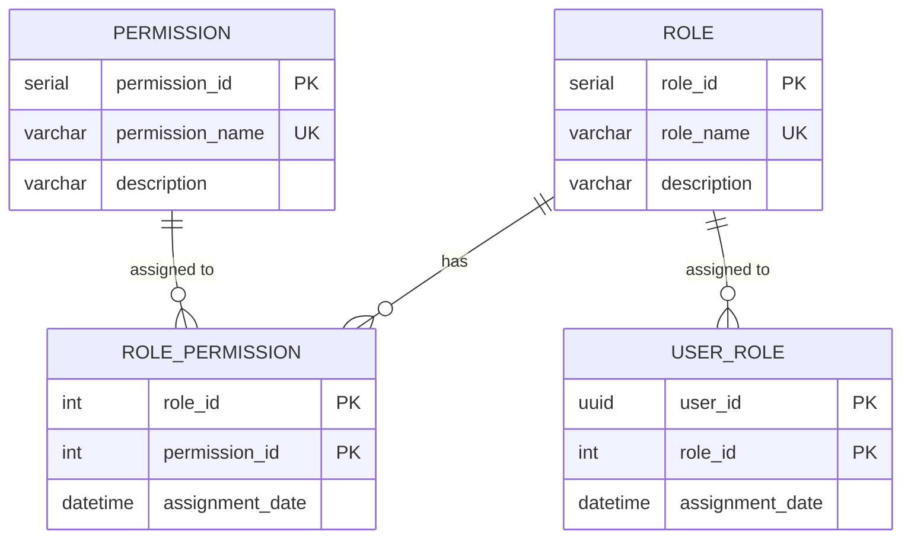

# Dominio: Authorization

> **Propietario:** Contexto delimitado Authorization
> **Motor de BD:** PostgreSQL 17 — transacciones ACID, integridad relacional para asociaciones rol-permiso
>
> **Justificación del motor:**
> - Las relaciones M:N entre roles, permisos y usuarios requieren integridad relacional.
> - Claves primarias SERIAL para identificadores internos no expuestos entre servicios.

---

## Principios de diseño

- Authorization **NO** depende directamente de Person.
- `user_id` actúa como referencia externa hacia el contexto Identity.
- Los roles son **globales** (sin `school_id`) — la misma estructura de roles aplica a todas las sedes.

---

## 1. Tabla: role

**Propósito:** Definición de los roles disponibles en el sistema (p. ej., Admin, Instructor, Student).

```sql
CREATE TABLE role (
  -- Business fields
  role_id       SERIAL      PRIMARY KEY,
  role_name     VARCHAR     NOT NULL UNIQUE,
  description   VARCHAR,

  -- Audit (in all tables)
  created_at    TIMESTAMP NOT NULL DEFAULT NOW(),
  updated_at    TIMESTAMP NOT NULL DEFAULT NOW(),
  deleted_at    TIMESTAMP,
  created_by    UUID,
  updated_by    UUID,
  deleted_by    UUID,
  row_version   BIGINT      NOT NULL DEFAULT 1
);
```

**Diccionario de datos:**

| Columna | Tipo | Descripción | Ejemplo |
|--------|------|-------------|---------|
| role_id | SERIAL | Identificador incremental del rol | `1` |
| role_name | VARCHAR | Nombre único del rol | `ADMIN` |
| description | VARCHAR | Descripción del rol | `Full system administrator` |
| created_at | TIMESTAMP | Cuándo se creó el registro | `2024-01-15T10:30:00Z` |
| updated_at | TIMESTAMP | Cuándo se actualizó el registro por última vez | `2024-01-15T10:30:00Z` |
| deleted_at | TIMESTAMP | NULL = activo; con valor = eliminado lógicamente | `NULL` |
| created_by | UUID | Usuario que creó este registro | `550e8400-...` |
| updated_by | UUID | Usuario que actualizó este registro por última vez | `550e8400-...` |
| deleted_by | UUID | Usuario que eliminó lógicamente este registro | `NULL` |
| row_version | BIGINT | Contador de versión para bloqueo optimista | `1` |

**Decisiones de modelado:**
1. `role_name` es globalmente único — los roles no son por sede en v4.
2. `role_id` es SERIAL porque es un identificador puramente interno.

---

## 2. Tabla: permission

**Propósito:** Catálogo global de permisos disponibles en el sistema.

```sql
CREATE TABLE permission (
  -- Business fields
  permission_id   SERIAL      PRIMARY KEY,
  permission_name VARCHAR     NOT NULL UNIQUE,
  description     VARCHAR,

  -- Audit (in all tables)
  created_at      TIMESTAMP NOT NULL DEFAULT NOW(),
  updated_at      TIMESTAMP NOT NULL DEFAULT NOW(),
  deleted_at      TIMESTAMP,
  created_by      UUID,
  updated_by      UUID,
  deleted_by      UUID,
  row_version     BIGINT      NOT NULL DEFAULT 1
);
```

**Diccionario de datos:**

| Columna | Tipo | Descripción | Ejemplo |
|--------|------|-------------|---------|
| permission_id | SERIAL | Identificador incremental del permiso | `1` |
| permission_name | VARCHAR | Nombre único del permiso (convención de espacios de nombres) | `attendance:read` |
| description | VARCHAR | Descripción del permiso | `View attendance records` |
| created_at | TIMESTAMP | Cuándo se creó el registro | `2024-01-15T10:30:00Z` |
| updated_at | TIMESTAMP | Cuándo se actualizó el registro por última vez | `2024-01-15T10:30:00Z` |
| deleted_at | TIMESTAMP | NULL = activo; con valor = eliminado lógicamente | `NULL` |
| created_by | UUID | Usuario que creó este registro | `550e8400-...` |
| updated_by | UUID | Usuario que actualizó este registro por última vez | `550e8400-...` |
| deleted_by | UUID | Usuario que eliminó lógicamente este registro | `NULL` |
| row_version | BIGINT | Contador de versión para bloqueo optimista | `1` |

---

## 3. Tabla: role_permission

**Propósito:** Asociación entre roles y permisos.

```sql
CREATE TABLE role_permission (
  -- Business fields
  role_id         INT         NOT NULL,
  permission_id   INT         NOT NULL,
  assignment_date TIMESTAMP NOT NULL DEFAULT NOW(),

  -- Audit (in all tables)
  created_at      TIMESTAMP NOT NULL DEFAULT NOW(),
  updated_at      TIMESTAMP NOT NULL DEFAULT NOW(),
  deleted_at      TIMESTAMP,
  created_by      UUID,
  updated_by      UUID,
  deleted_by      UUID,
  row_version     BIGINT      NOT NULL DEFAULT 1,

  PRIMARY KEY (role_id, permission_id)
);

ALTER TABLE role_permission ADD CONSTRAINT fk_rp_role
  FOREIGN KEY (role_id) REFERENCES role(role_id);
ALTER TABLE role_permission ADD CONSTRAINT fk_rp_permission
  FOREIGN KEY (permission_id) REFERENCES permission(permission_id);
```

**Diccionario de datos:**

| Columna | Tipo | Descripción | Ejemplo |
|--------|------|-------------|---------|
| role_id | INT | Rol que recibe el permiso (FK → role) | `1` |
| permission_id | INT | Permiso que se asigna (FK → permission) | `3` |
| assignment_date | TIMESTAMP | Cuándo se asignó el permiso | `2024-01-15T10:30:00Z` |
| created_at | TIMESTAMP | Cuándo se creó el registro | `2024-01-15T10:30:00Z` |
| updated_at | TIMESTAMP | Cuándo se actualizó el registro por última vez | `2024-01-15T10:30:00Z` |
| deleted_at | TIMESTAMP | NULL = activo; con valor = eliminado lógicamente | `NULL` |
| created_by | UUID | Usuario que creó este registro | `550e8400-...` |
| updated_by | UUID | Usuario que actualizó este registro por última vez | `550e8400-...` |
| deleted_by | UUID | Usuario que eliminó lógicamente este registro | `NULL` |
| row_version | BIGINT | Contador de versión para bloqueo optimista | `1` |

---

## 4. Tabla: user_role

**Propósito:** Asignación de roles a usuarios específicos.

```sql
CREATE TABLE user_role (
  -- Business fields
  user_id         UUID        NOT NULL,
  role_id         INT         NOT NULL,
  assignment_date TIMESTAMP NOT NULL DEFAULT NOW(),

  -- Audit (in all tables)
  created_at      TIMESTAMP NOT NULL DEFAULT NOW(),
  updated_at      TIMESTAMP NOT NULL DEFAULT NOW(),
  deleted_at      TIMESTAMP,
  created_by      UUID,
  updated_by      UUID,
  deleted_by      UUID,
  row_version     BIGINT      NOT NULL DEFAULT 1,

  PRIMARY KEY (user_id, role_id)
);

ALTER TABLE user_role ADD CONSTRAINT fk_ur_role
  FOREIGN KEY (role_id) REFERENCES role(role_id);
```

**Diccionario de datos:**

| Columna | Tipo | Descripción | Ejemplo |
|--------|------|-------------|---------|
| user_id | UUID | Usuario que recibe el rol (ID externo → Identity.app_user) | `550e8400-...` |
| role_id | INT | Rol que se asigna (FK → role) | `1` |
| assignment_date | TIMESTAMP | Cuándo se asignó el rol | `2024-01-15T10:30:00Z` |
| created_at | TIMESTAMP | Cuándo se creó el registro | `2024-01-15T10:30:00Z` |
| updated_at | TIMESTAMP | Cuándo se actualizó el registro por última vez | `2024-01-15T10:30:00Z` |
| deleted_at | TIMESTAMP | NULL = activo; con valor = eliminado lógicamente | `NULL` |
| created_by | UUID | Usuario que creó este registro | `550e8400-...` |
| updated_by | UUID | Usuario que actualizó este registro por última vez | `550e8400-...` |
| deleted_by | UUID | Usuario que eliminó lógicamente este registro | `NULL` |
| row_version | BIGINT | Contador de versión para bloqueo optimista | `1` |

**Decisiones de modelado:**
1. `user_id` es una referencia externa (UUID de Identity.app_user) — **sin FK física** para respetar el aislamiento de contextos delimitados.
2. Un usuario puede tener múltiples roles (M:N).

---

## 5. Diagrama de relaciones



---

## 6. Relaciones entre contextos

| Origen | Destino | Tipo de referencia | Mecanismo |
|------|----|----------------|-----------|
| User_Role.user_id | Identity.App_User.user_id | ID externo (sin FK) | Referencia entre contextos por UUID |

---

## 7. Correlaciones

- Entidades de dominio que se mapean a estas tablas → `02-domain/entities-and-rules.md`
- Patrón Saga y Outbox para consistencia distribuida → `05-architecture/pattern-guide.md`
- Datos de cada servicio en detalle → `09-microservices/services/authorization-service/data-model.md`
- Cómo se accede a los datos vía API → `07-api/contracts/openapi/`
