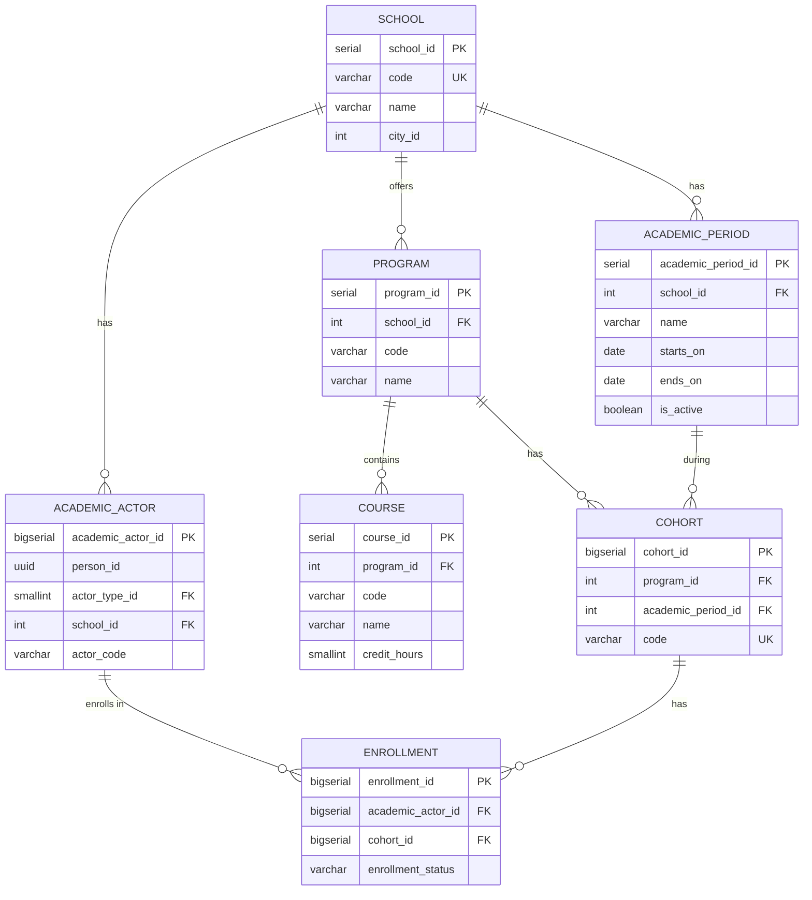

# Dominio: Academic

> **Propietario:** Contexto delimitado Academic
> **Motor de BD:** PostgreSQL 17 — transacciones ACID, relaciones complejas, gestión de matrículas
>
> **Justificación del motor:**
> - Modelo relacional complejo con múltiples FK para la jerarquía sede-programa-cohorte-curso.
> - `academic_actor` unificado reemplaza las tablas separadas de Student/Teacher.

---

## Principios de diseño

- Academic es dueño de: school, program, academic_period, cohort, course, academic_actor_type, academic_actor, enrollment.
- `person_id` en academic_actor es una referencia externa hacia Identity — sin FK entre contextos.
- `academic_actor` unifica estudiantes e instructores en una sola tabla con `actor_type`.

---

## 1. Tabla: school

**Propósito:** Registro institucional de cada sede en la plataforma multitenant.

```sql
CREATE TABLE school (
  -- Business fields
  school_id     SERIAL      PRIMARY KEY,
  code          VARCHAR     NOT NULL UNIQUE,
  name          VARCHAR     NOT NULL,
  -- External catalog via countriesnow API, no FK (DBML v6/v7: city table removed)
  city_id       VARCHAR     NULL,
  address       VARCHAR,
  district      VARCHAR     NULL,
  country       VARCHAR     NULL,
  city_name     VARCHAR     NULL,
  phone         VARCHAR,
  email         VARCHAR,

  -- Status fields
  status        BOOLEAN     NOT NULL DEFAULT true,

  -- Audit (in all tables)
  created_at    TIMESTAMP NOT NULL DEFAULT NOW(),
  updated_at    TIMESTAMP NOT NULL DEFAULT NOW(),
  deleted_at    TIMESTAMP,
  created_by    UUID,
  updated_by    UUID,
  deleted_by    UUID,
  row_version   BIGINT      NOT NULL DEFAULT 1
);
```

**Diccionario de datos:**

| Columna | Tipo | Descripción | Ejemplo |
|--------|------|-------------|---------|
| school_id | SERIAL | Identificador incremental de la sede | `1` |
| code | VARCHAR | Código único de la sede | `ESC-001` |
| name | VARCHAR | Nombre de la institución | `Escuela Nacional` |
| city_id | VARCHAR | Id externo de ciudad (API countriesnow, sin FK, NULL permitido) | `CO-BOG` |
| address | VARCHAR | Dirección física | `Calle 123 #45-67` |
| district | VARCHAR | Distrito/departamento | `Cundinamarca` |
| country | VARCHAR | País | `Colombia` |
| city_name | VARCHAR | Etiqueta de ciudad desnormalizada desde la API externa | `Bogota` |
| phone | VARCHAR | Número de teléfono de contacto | `+57 300 123 4567` |
| email | VARCHAR | Correo institucional | `info@escuela.edu.co` |
| status | BOOLEAN | Indicador de activo/inactivo | `true` |
| created_at | TIMESTAMP | Cuándo se creó el registro | `2024-01-15T10:30:00Z` |
| updated_at | TIMESTAMP | Cuándo se actualizó el registro por última vez | `2024-01-15T10:30:00Z` |
| deleted_at | TIMESTAMP | NULL = activo; con valor = eliminado lógicamente | `NULL` |
| created_by | UUID | Usuario que creó este registro | `550e8400-...` |
| updated_by | UUID | Usuario que actualizó este registro por última vez | `550e8400-...` |
| deleted_by | UUID | Usuario que eliminó lógicamente este registro | `NULL` |
| row_version | BIGINT | Contador de versión para bloqueo optimista | `1` |

**Decisiones de modelado:**
1. `school_id` es SERIAL (no UUID) — identificador interno, no expuesto entre contextos.
2. `code` es el identificador de negocio usado en APIs e informes.
3. `city_id` es un id de catálogo externo (VARCHAR NULL, sin FK) — `identity.city` está obsoleta; las ciudades provienen de `countriesnow.space`. `district/country/city_name` son campos de visualización de esa API.

---

## 2. Tabla: program

**Propósito:** Programas académicos ofrecidos por una sede (p. ej., Ingeniería, Medicina).

```sql
CREATE TABLE program (
  -- Business fields
  program_id    SERIAL      PRIMARY KEY,
  school_id     INT         NOT NULL,
  code          VARCHAR     NOT NULL,
  name          VARCHAR     NOT NULL,

  -- Status fields
  status        BOOLEAN     NOT NULL DEFAULT true,

  -- Audit (in all tables)
  created_at    TIMESTAMP NOT NULL DEFAULT NOW(),
  updated_at    TIMESTAMP NOT NULL DEFAULT NOW(),
  deleted_at    TIMESTAMP,
  created_by    UUID,
  updated_by    UUID,
  deleted_by    UUID,
  row_version   BIGINT      NOT NULL DEFAULT 1
);

CREATE UNIQUE INDEX uq_program_code_school ON program (school_id, code);
```

**Diccionario de datos:**

| Columna | Tipo | Descripción | Ejemplo |
|--------|------|-------------|---------|
| program_id | SERIAL | Identificador incremental del programa | `1` |
| school_id | INT | Sede propietaria (FK → school) | `1` |
| code | VARCHAR | Código del programa dentro de la sede | `ING-SIS` |
| name | VARCHAR | Nombre del programa | `Systems Engineering` |
| status | BOOLEAN | Indicador de activo/inactivo | `true` |
| created_at | TIMESTAMP | Cuándo se creó el registro | `2024-01-15T10:30:00Z` |
| updated_at | TIMESTAMP | Cuándo se actualizó el registro por última vez | `2024-01-15T10:30:00Z` |
| deleted_at | TIMESTAMP | NULL = activo; con valor = eliminado lógicamente | `NULL` |
| created_by | UUID | Usuario que creó este registro | `550e8400-...` |
| updated_by | UUID | Usuario que actualizó este registro por última vez | `550e8400-...` |
| deleted_by | UUID | Usuario que eliminó lógicamente este registro | `NULL` |
| row_version | BIGINT | Contador de versión para bloqueo optimista | `1` |

---

## 3. Tabla: academic_period

**Propósito:** Períodos académicos (semestres, trimestres).

```sql
CREATE TABLE academic_period (
  -- Business fields
  academic_period_id  SERIAL      PRIMARY KEY,
  school_id           INT         NOT NULL,
  name                VARCHAR     NOT NULL,
  starts_on           DATE        NOT NULL,
  ends_on             DATE        NOT NULL CHECK (ends_on > starts_on),

  -- Status fields
  is_active           BOOLEAN     NOT NULL DEFAULT false,

  -- Audit (in all tables)
  created_at          TIMESTAMP NOT NULL DEFAULT NOW(),
  updated_at          TIMESTAMP NOT NULL DEFAULT NOW(),
  deleted_at          TIMESTAMP,
  created_by          UUID,
  updated_by          UUID,
  deleted_by          UUID,
  row_version         BIGINT      NOT NULL DEFAULT 1,

  CONSTRAINT chk_period_dates CHECK (starts_on < ends_on)
);

CREATE UNIQUE INDEX uq_period_name_school ON academic_period (school_id, name);
```

**Diccionario de datos:**

| Columna | Tipo | Descripción | Ejemplo |
|--------|------|-------------|---------|
| academic_period_id | SERIAL | Identificador incremental del período | `1` |
| school_id | INT | Sede propietaria (FK → school) | `1` |
| name | VARCHAR | Nombre del período | `2026-S1` |
| starts_on | DATE | Fecha de inicio del período | `2026-01-15` |
| ends_on | DATE | Fecha de fin del período | `2026-06-30` |
| is_active | BOOLEAN | Indica si es el período activo actual | `true` |
| created_at | TIMESTAMP | Cuándo se creó el registro | `2024-01-15T10:30:00Z` |
| updated_at | TIMESTAMP | Cuándo se actualizó el registro por última vez | `2024-01-15T10:30:00Z` |
| deleted_at | TIMESTAMP | NULL = activo; con valor = eliminado lógicamente | `NULL` |
| created_by | UUID | Usuario que creó este registro | `550e8400-...` |
| updated_by | UUID | Usuario que actualizó este registro por última vez | `550e8400-...` |
| deleted_by | UUID | Usuario que eliminó lógicamente este registro | `NULL` |
| row_version | BIGINT | Contador de versión para bloqueo optimista | `1` |

---

## 4. Tabla: cohort

**Propósito:** Grupo de estudiantes matriculados en un programa durante un período específico.

```sql
CREATE TABLE cohort (
  -- Business fields
  cohort_id           BIGSERIAL   PRIMARY KEY,
  program_id          INT         NOT NULL,
  academic_period_id  INT         NOT NULL,
  code                VARCHAR     NOT NULL UNIQUE,

  -- Status fields
  status              BOOLEAN     NOT NULL DEFAULT true,

  -- Audit (in all tables)
  created_at          TIMESTAMP NOT NULL DEFAULT NOW(),
  updated_at          TIMESTAMP NOT NULL DEFAULT NOW(),
  deleted_at          TIMESTAMP,
  created_by          UUID,
  updated_by          UUID,
  deleted_by          UUID,
  row_version         BIGINT      NOT NULL DEFAULT 1
);
```

**Diccionario de datos:**

| Columna | Tipo | Descripción | Ejemplo |
|--------|------|-------------|---------|
| cohort_id | BIGSERIAL | Identificador incremental de la cohorte | `1` |
| program_id | INT | Programa (FK → program) | `1` |
| academic_period_id | INT | Período académico (FK → academic_period) | `1` |
| code | VARCHAR | Código de cohorte globalmente único | `ING-SIS-2026-S1-01` |
| status | BOOLEAN | Indicador de activo/inactivo | `true` |
| created_at | TIMESTAMP | Cuándo se creó el registro | `2024-01-15T10:30:00Z` |
| updated_at | TIMESTAMP | Cuándo se actualizó el registro por última vez | `2024-01-15T10:30:00Z` |
| deleted_at | TIMESTAMP | NULL = activo; con valor = eliminado lógicamente | `NULL` |
| created_by | UUID | Usuario que creó este registro | `550e8400-...` |
| updated_by | UUID | Usuario que actualizó este registro por última vez | `550e8400-...` |
| deleted_by | UUID | Usuario que eliminó lógicamente este registro | `NULL` |
| row_version | BIGINT | Contador de versión para bloqueo optimista | `1` |

---

## 5. Tabla: course

**Propósito:** Cursos dentro de un programa, con horas de crédito.

```sql
CREATE TABLE course (
  -- Business fields
  course_id     SERIAL      PRIMARY KEY,
  program_id    INT         NOT NULL,
  code          VARCHAR     NOT NULL,
  name          VARCHAR     NOT NULL,
  credit_hours  SMALLINT    NOT NULL,

  -- Status fields
  status        BOOLEAN     NOT NULL DEFAULT true,

  -- Audit (in all tables)
  created_at    TIMESTAMP NOT NULL DEFAULT NOW(),
  updated_at    TIMESTAMP NOT NULL DEFAULT NOW(),
  deleted_at    TIMESTAMP,
  created_by    UUID,
  updated_by    UUID,
  deleted_by    UUID,
  row_version   BIGINT      NOT NULL DEFAULT 1
);

CREATE UNIQUE INDEX uq_course_code_program ON course (program_id, code);
```

**Diccionario de datos:**

| Columna | Tipo | Descripción | Ejemplo |
|--------|------|-------------|---------|
| course_id | SERIAL | Identificador incremental del curso | `1` |
| program_id | INT | Programa propietario (FK → program) | `1` |
| code | VARCHAR | Código del curso dentro del programa | `MAT-101` |
| name | VARCHAR | Nombre del curso | `Calculus I` |
| credit_hours | SMALLINT | Número de horas de crédito | `4` |
| status | BOOLEAN | Indicador de activo/inactivo | `true` |
| created_at | TIMESTAMP | Cuándo se creó el registro | `2024-01-15T10:30:00Z` |
| updated_at | TIMESTAMP | Cuándo se actualizó el registro por última vez | `2024-01-15T10:30:00Z` |
| deleted_at | TIMESTAMP | NULL = activo; con valor = eliminado lógicamente | `NULL` |
| created_by | UUID | Usuario que creó este registro | `550e8400-...` |
| updated_by | UUID | Usuario que actualizó este registro por última vez | `550e8400-...` |
| deleted_by | UUID | Usuario que eliminó lógicamente este registro | `NULL` |
| row_version | BIGINT | Contador de versión para bloqueo optimista | `1` |

---

## 6. Tabla: academic_actor_type

**Propósito:** Catálogo de tipos de actor académico (STUDENT, INSTRUCTOR).

```sql
CREATE TABLE academic_actor_type (
  -- Business fields
  actor_type_id SMALLINT    PRIMARY KEY,
  code          VARCHAR     NOT NULL UNIQUE,
  name          VARCHAR     NOT NULL,

  -- Audit (in all tables)
  created_at    TIMESTAMP NOT NULL DEFAULT NOW(),
  updated_at    TIMESTAMP NOT NULL DEFAULT NOW(),
  deleted_at    TIMESTAMP,
  created_by    UUID,
  updated_by    UUID,
  deleted_by    UUID,
  row_version   BIGINT      NOT NULL DEFAULT 1
);
```

**Diccionario de datos:**

| Columna | Tipo | Descripción | Ejemplo |
|--------|------|-------------|---------|
| actor_type_id | SMALLINT | Identificador incremental del tipo | `1` |
| code | VARCHAR | Código del tipo (único) | `STUDENT` |
| name | VARCHAR | Nombre del tipo | `Student` |
| created_at | TIMESTAMP | Cuándo se creó el registro | `2024-01-15T10:30:00Z` |
| updated_at | TIMESTAMP | Cuándo se actualizó el registro por última vez | `2024-01-15T10:30:00Z` |
| deleted_at | TIMESTAMP | NULL = activo; con valor = eliminado lógicamente | `NULL` |
| created_by | UUID | Usuario que creó este registro | `550e8400-...` |
| updated_by | UUID | Usuario que actualizó este registro por última vez | `550e8400-...` |
| deleted_by | UUID | Usuario que eliminó lógicamente este registro | `NULL` |
| row_version | BIGINT | Contador de versión para bloqueo optimista | `1` |

---

## 7. Tabla: academic_actor

**Propósito:** Tabla unificada de estudiantes e instructores. Reemplaza las tablas separadas de Student/Teacher.

```sql
CREATE TABLE academic_actor (
  -- Business fields
  academic_actor_id BIGSERIAL   PRIMARY KEY,
  person_id         UUID        NOT NULL,
  actor_type_id     SMALLINT    NOT NULL,
  school_id         INT         NOT NULL,
  actor_code        VARCHAR     NOT NULL,
  started_on        DATE        NOT NULL,
  ended_on          DATE,

  -- Status fields
  status            BOOLEAN     NOT NULL DEFAULT true,

  -- Audit (in all tables)
  created_at        TIMESTAMP NOT NULL DEFAULT NOW(),
  updated_at        TIMESTAMP NOT NULL DEFAULT NOW(),
  deleted_at        TIMESTAMP,
  created_by        UUID,
  updated_by        UUID,
  deleted_by        UUID,
  row_version       BIGINT      NOT NULL DEFAULT 1
);

CREATE UNIQUE INDEX uq_actor_code_school_type
  ON academic_actor (school_id, actor_type_id, actor_code);
CREATE UNIQUE INDEX uq_actor_person_type_school
  ON academic_actor (person_id, actor_type_id, school_id);
CREATE INDEX idx_actor_deleted ON academic_actor (deleted_at) WHERE deleted_at IS NULL;
```

**Diccionario de datos:**

| Columna | Tipo | Descripción | Ejemplo |
|--------|------|-------------|---------|
| academic_actor_id | BIGSERIAL | Identificador incremental del actor | `1` |
| person_id | UUID | Identidad externa (→ Identity.person) | `550e8400-...` |
| actor_type_id | SMALLINT | Tipo de actor (FK → academic_actor_type) | `1` |
| school_id | INT | Sede (FK → school) | `1` |
| actor_code | VARCHAR | Código institucional de este actor | `EST-2024-001` |
| started_on | DATE | Cuándo el actor inició en este rol | `2024-01-15` |
| ended_on | DATE | Cuándo el actor terminó este rol (NULL = activo) | `NULL` |
| status | BOOLEAN | Indicador de activo/inactivo | `true` |
| created_at | TIMESTAMP | Cuándo se creó el registro | `2024-01-15T10:30:00Z` |
| updated_at | TIMESTAMP | Cuándo se actualizó el registro por última vez | `2024-01-15T10:30:00Z` |
| deleted_at | TIMESTAMP | NULL = activo; con valor = eliminado lógicamente | `NULL` |
| created_by | UUID | Usuario que creó este registro | `550e8400-...` |
| updated_by | UUID | Usuario que actualizó este registro por última vez | `550e8400-...` |
| deleted_by | UUID | Usuario que eliminó lógicamente este registro | `NULL` |
| row_version | BIGINT | Contador de versión para bloqueo optimista | `1` |

**Decisiones de modelado:**
1. Tabla unificada: una persona puede ser tanto estudiante como instructor (distinto `actor_type_id`).
2. `person_id` es una referencia externa hacia Identity — sin FK entre contextos.
3. Dos restricciones únicas: código por sede+tipo, y persona por tipo+sede.

---

## 8. Tabla: enrollment

**Propósito:** Matrícula de un academic_actor en una cohorte.

```sql
-- Native ENUM: CREATE TYPE academic.enrollment_status AS ENUM ('Active','Withdrawn','Completed');
CREATE TABLE enrollment (
  -- Business fields
  enrollment_id       BIGSERIAL   PRIMARY KEY,
  academic_actor_id   BIGINT      NOT NULL,
  cohort_id           BIGINT      NOT NULL,
  enrolled_on         DATE        NOT NULL,

  -- Status fields
  enrollment_status   academic.enrollment_status NOT NULL,

  -- Audit (in all tables)
  created_at          TIMESTAMP NOT NULL DEFAULT NOW(),
  updated_at          TIMESTAMP NOT NULL DEFAULT NOW(),
  deleted_at          TIMESTAMP,
  created_by          UUID,
  updated_by          UUID,
  deleted_by          UUID,
  row_version         BIGINT      NOT NULL DEFAULT 1
);

CREATE UNIQUE INDEX uq_enrollment_actor_cohort
  ON enrollment (academic_actor_id, cohort_id);
CREATE INDEX idx_enrollment_cohort ON enrollment (cohort_id);
CREATE INDEX idx_enrollment_deleted ON enrollment (deleted_at) WHERE deleted_at IS NULL;
```

**Diccionario de datos:**

| Columna | Tipo | Descripción | Ejemplo |
|--------|------|-------------|---------|
| enrollment_id | BIGSERIAL | Identificador incremental de la matrícula | `1` |
| academic_actor_id | BIGINT | Actor matriculado (FK → academic_actor) | `1` |
| cohort_id | BIGINT | Cohorte destino (FK → cohort) | `1` |
| enrolled_on | DATE | Fecha de matrícula | `2024-01-15` |
| enrollment_status | VARCHAR | Estado: Active (Activa), Withdrawn (Retirada), Completed (Completada) | `Active` |
| created_at | TIMESTAMP | Cuándo se creó el registro | `2024-01-15T10:30:00Z` |
| updated_at | TIMESTAMP | Cuándo se actualizó el registro por última vez | `2024-01-15T10:30:00Z` |
| deleted_at | TIMESTAMP | NULL = activo; con valor = eliminado lógicamente | `NULL` |
| created_by | UUID | Usuario que creó este registro | `550e8400-...` |
| updated_by | UUID | Usuario que actualizó este registro por última vez | `550e8400-...` |
| deleted_by | UUID | Usuario que eliminó lógicamente este registro | `NULL` |
| row_version | BIGINT | Contador de versión para bloqueo optimista | `1` |

---

## 9. Diagrama de relaciones



---

## 10. Relaciones entre contextos

| Origen | Destino | Tipo de referencia | Mecanismo |
|------|----|----------------|-----------|
| School.city_id | API externa countriesnow | Catálogo externo (sin FK) | Id de visualización VARCHAR NULL + city_name/district/country |
| Academic_Actor.person_id | Identity.Person.person_id | ID externo (sin FK) | Referencia entre contextos por UUID |
| Scheduling.Schedule_Block.cohort_id | Academic.Cohort.cohort_id | ID externo (sin FK) | Referencia entre contextos por BIGINT |
| Scheduling.Schedule_Block.course_id | Academic.Course.course_id | ID externo (sin FK) | Referencia entre contextos por SERIAL |
| Scheduling.Class_Session.opened_by | Academic.Academic_Actor.academic_actor_id | ID externo (sin FK) | Referencia entre contextos por BIGINT |
| Attendance.Attendance_Record.academic_actor_id | Academic.Academic_Actor.academic_actor_id | ID externo (sin FK) | Referencia entre contextos por BIGINT |

---

## 11. Correlaciones

- Entidades de dominio que se mapean a estas tablas → `02-domain/entities-and-rules.md`
- Patrón Saga y Outbox para consistencia distribuida → `05-architecture/pattern-guide.md`
- Datos de cada servicio en detalle → `09-microservices/services/academic-service/data-model.md`
- Cómo se accede a los datos vía API → `07-api/contracts/openapi/`
