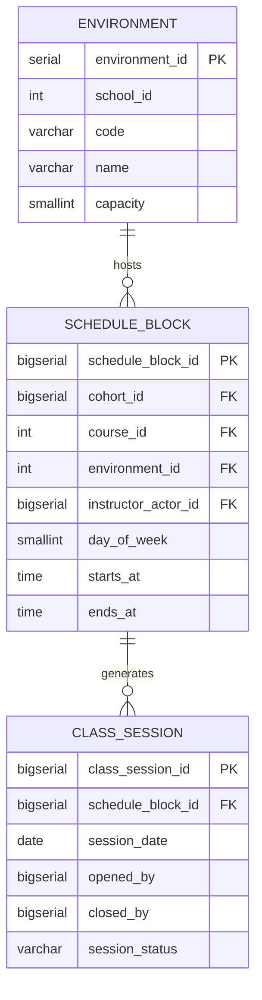

# Dominio: Scheduling

> **Propietario:** Contexto delimitado Scheduling
> **Motor de BD:** PostgreSQL 17 — transacciones ACID, prevención de conflictos en reserva de salas/instructores
>
> **Justificación del motor:**
> - Restricciones únicas sobre (ambiente, día, hora) e (instructor, día, hora) que evitan la doble reserva.
> - Separado de Academic para permitir la evolución independiente de la gestión de horarios.

---

## Principios de diseño

- Scheduling es dueño de: environment, schedule_block, class_session.
- `cohort_id`, `course_id`, `instructor_actor_id` son referencias externas hacia Academic — sin FK entre contextos.
- `environment.school_id` es una referencia externa hacia Academic.school.

---

## 1. Tabla: environment

**Propósito:** Espacios físicos donde se imparten las clases (aulas, laboratorios, auditorios).

```sql
CREATE TABLE environment (
  -- Business fields
  environment_id  SERIAL      PRIMARY KEY,
  school_id       INT         NOT NULL,
  code            VARCHAR     NOT NULL,
  name            VARCHAR     NOT NULL,
  capacity        SMALLINT    NOT NULL,

  -- Status fields
  status          BOOLEAN     NOT NULL DEFAULT true,

  -- Audit (in all tables)
  created_at      TIMESTAMP NOT NULL DEFAULT NOW(),
  updated_at      TIMESTAMP NOT NULL DEFAULT NOW(),
  deleted_at      TIMESTAMP,
  created_by      UUID,
  updated_by      UUID,
  deleted_by      UUID,
  row_version     BIGINT      NOT NULL DEFAULT 1
);

CREATE UNIQUE INDEX uq_environment_code_school ON environment (school_id, code);
```

**Diccionario de datos:**

| Columna | Tipo | Descripción | Ejemplo |
|--------|------|-------------|---------|
| environment_id | SERIAL | Identificador incremental del ambiente | `1` |
| school_id | INT | Sede propietaria (ID externo → Academic.school) | `1` |
| code | VARCHAR | Código del ambiente dentro de la sede | `SAL-101` |
| name | VARCHAR | Nombre del ambiente | `Room 101` |
| capacity | SMALLINT | Ocupación máxima | `30` |
| status | BOOLEAN | Indicador de activo/inactivo | `true` |
| created_at | TIMESTAMP | Cuándo se creó el registro | `2024-01-15T10:30:00Z` |
| updated_at | TIMESTAMP | Cuándo se actualizó el registro por última vez | `2024-01-15T10:30:00Z` |
| deleted_at | TIMESTAMP | NULL = activo; con valor = eliminado lógicamente | `NULL` |
| created_by | UUID | Usuario que creó este registro | `550e8400-...` |
| updated_by | UUID | Usuario que actualizó este registro por última vez | `550e8400-...` |
| deleted_by | UUID | Usuario que eliminó lógicamente este registro | `NULL` |
| row_version | BIGINT | Contador de versión para bloqueo optimista | `1` |

---

## 2. Tabla: schedule_block

**Propósito:** Franja horaria recurrente en el horario (p. ej., "Cálculo I, lunes 8:00-9:30, Salón 101").

```sql
CREATE TABLE schedule_block (
  -- Business fields
  schedule_block_id   BIGSERIAL   PRIMARY KEY,
  cohort_id           BIGINT      NOT NULL,
  course_id           INT         NOT NULL,
  environment_id      INT         NOT NULL,
  instructor_actor_id BIGINT      NOT NULL,
  day_of_week         SMALLINT    NOT NULL CHECK (day_of_week BETWEEN 1 AND 7),
  starts_at           TIME        NOT NULL,
  ends_at             TIME        NOT NULL CHECK (ends_at > starts_at),

  -- Audit (in all tables)
  created_at          TIMESTAMP NOT NULL DEFAULT NOW(),
  updated_at          TIMESTAMP NOT NULL DEFAULT NOW(),
  deleted_at          TIMESTAMP,
  created_by          UUID,
  updated_by          UUID,
  deleted_by          UUID,
  row_version         BIGINT      NOT NULL DEFAULT 1,

  CONSTRAINT chk_block_day_of_week CHECK (day_of_week BETWEEN 1 AND 7),
  CONSTRAINT chk_block_time CHECK (starts_at < ends_at)
);

CREATE UNIQUE INDEX uq_block_environment_slot
  ON schedule_block (environment_id, day_of_week, starts_at);
CREATE UNIQUE INDEX uq_block_instructor_slot
  ON schedule_block (instructor_actor_id, day_of_week, starts_at);
CREATE INDEX idx_block_cohort ON schedule_block (cohort_id);
CREATE INDEX idx_block_course ON schedule_block (course_id);
```

**Diccionario de datos:**

| Columna | Tipo | Descripción | Ejemplo |
|--------|------|-------------|---------|
| schedule_block_id | BIGSERIAL | Identificador incremental del bloque | `1` |
| cohort_id | BIGINT | Cohorte destino (ID externo → Academic.cohort) | `1` |
| course_id | INT | Curso que se imparte (ID externo → Academic.course) | `1` |
| environment_id | INT | Aula (FK → environment) | `1` |
| instructor_actor_id | BIGINT | Instructor (ID externo → Academic.academic_actor) | `1` |
| day_of_week | SMALLINT | Día de la semana (1..7) | `1` |
| starts_at | TIME | Hora de inicio del bloque | `08:00` |
| ends_at | TIME | Hora de fin del bloque | `09:30` |
| created_at | TIMESTAMP | Cuándo se creó el registro | `2024-01-15T10:30:00Z` |
| updated_at | TIMESTAMP | Cuándo se actualizó el registro por última vez | `2024-01-15T10:30:00Z` |
| deleted_at | TIMESTAMP | NULL = activo; con valor = eliminado lógicamente | `NULL` |
| created_by | UUID | Usuario que creó este registro | `550e8400-...` |
| updated_by | UUID | Usuario que actualizó este registro por última vez | `550e8400-...` |
| deleted_by | UUID | Usuario que eliminó lógicamente este registro | `NULL` |
| row_version | BIGINT | Contador de versión para bloqueo optimista | `1` |

**Decisiones de modelado:**
1. Dos restricciones únicas evitan la doble reserva: misma sala a la misma hora, o mismo instructor a la misma hora.
2. `day_of_week` es SMALLINT 1..7 ISO con `chk_block_day_of_week`; `starts_at < ends_at` con `chk_block_time`.
3. `cohort_id`, `course_id`, `instructor_actor_id` son referencias externas — sin FK entre contextos.

---

## 3. Tabla: class_session

**Propósito:** Ocurrencia real de un schedule_block en una fecha concreta. Abierta/cerrada por el instructor.

```sql
-- Native ENUM: CREATE TYPE scheduling.class_session_status AS ENUM ('Open','Closed','Cancelled');
CREATE TABLE class_session (
  -- Business fields
  class_session_id  BIGSERIAL   PRIMARY KEY,
  schedule_block_id BIGINT      NOT NULL,
  session_date      DATE        NOT NULL,
  opened_by         BIGINT,
  opened_at         TIMESTAMP,
  closed_by         BIGINT,
  closed_at         TIMESTAMP,

  -- Status fields
  session_status    scheduling.class_session_status NOT NULL,

  -- Audit (in all tables)
  created_at        TIMESTAMP NOT NULL DEFAULT NOW(),
  updated_at        TIMESTAMP NOT NULL DEFAULT NOW(),
  deleted_at        TIMESTAMP,
  created_by        UUID,
  updated_by        UUID,
  deleted_by        UUID,
  row_version       BIGINT      NOT NULL DEFAULT 1
);

CREATE UNIQUE INDEX uq_session_block_date ON class_session (schedule_block_id, session_date);
CREATE INDEX idx_session_date ON class_session (session_date);
```

**Diccionario de datos:**

| Columna | Tipo | Descripción | Ejemplo |
|--------|------|-------------|---------|
| class_session_id | BIGSERIAL | Identificador incremental de la sesión | `1` |
| schedule_block_id | BIGINT | Bloque de horario padre (FK → schedule_block) | `1` |
| session_date | DATE | Fecha de esta sesión | `2024-06-01` |
| opened_by | BIGINT | Instructor que abrió la clase (ID externo → Academic.academic_actor) | `1` |
| opened_at | TIMESTAMP | Cuándo el instructor abrió la clase | `2024-06-01T08:00:00Z` |
| closed_by | BIGINT | Instructor que cerró la clase (ID externo) | `1` |
| closed_at | TIMESTAMP | Cuándo el instructor cerró la clase | `2024-06-01T09:30:00Z` |
| session_status | VARCHAR | Estado: Open (Abierta), Closed (Cerrada), Cancelled (Cancelada) | `Open` |
| created_at | TIMESTAMP | Cuándo se creó el registro | `2024-06-01T08:00:00Z` |
| updated_at | TIMESTAMP | Cuándo se actualizó el registro por última vez | `2024-06-01T08:00:00Z` |
| deleted_at | TIMESTAMP | NULL = activo; con valor = eliminado lógicamente | `NULL` |
| created_by | UUID | Usuario que creó este registro | `550e8400-...` |
| updated_by | UUID | Usuario que actualizó este registro por última vez | `550e8400-...` |
| deleted_by | UUID | Usuario que eliminó lógicamente este registro | `NULL` |
| row_version | BIGINT | Contador de versión para bloqueo optimista | `1` |

**Decisiones de modelado:**
1. Una sesión por bloque por fecha — sin duplicados.
2. `opened_by`/`closed_by` pueden diferir del instructor programado (sustitución).
3. Las sesiones se crean bajo demanda cuando el instructor inicia la clase.

---

## 4. Diagrama de relaciones



---

## 5. Relaciones entre contextos

| Origen | Destino | Tipo de referencia | Mecanismo |
|------|----|----------------|-----------|
| Environment.school_id | Academic.School.school_id | ID externo (sin FK) | Referencia entre contextos por SERIAL |
| Schedule_Block.cohort_id | Academic.Cohort.cohort_id | ID externo (sin FK) | Referencia entre contextos por BIGINT |
| Schedule_Block.course_id | Academic.Course.course_id | ID externo (sin FK) | Referencia entre contextos por SERIAL |
| Schedule_Block.instructor_actor_id | Academic.Academic_Actor.academic_actor_id | ID externo (sin FK) | Referencia entre contextos por BIGINT |
| Class_Session.opened_by | Academic.Academic_Actor.academic_actor_id | ID externo (sin FK) | Referencia entre contextos por BIGINT |
| Class_Session.closed_by | Academic.Academic_Actor.academic_actor_id | ID externo (sin FK) | Referencia entre contextos por BIGINT |
| Attendance.Attendance_Record.class_session_id | Scheduling.Class_Session.class_session_id | ID externo (sin FK) | Referencia entre contextos por BIGINT |

---

## 6. Correlaciones

- Entidades de dominio que se mapean a estas tablas → `02-domain/entities-and-rules.md`
- Patrón Saga y Outbox para consistencia distribuida → `05-architecture/pattern-guide.md`
- Datos de cada servicio en detalle → `09-microservices/services/scheduling-service/data-model.md`
- Cómo se accede a los datos vía API → `07-api/contracts/openapi/`
