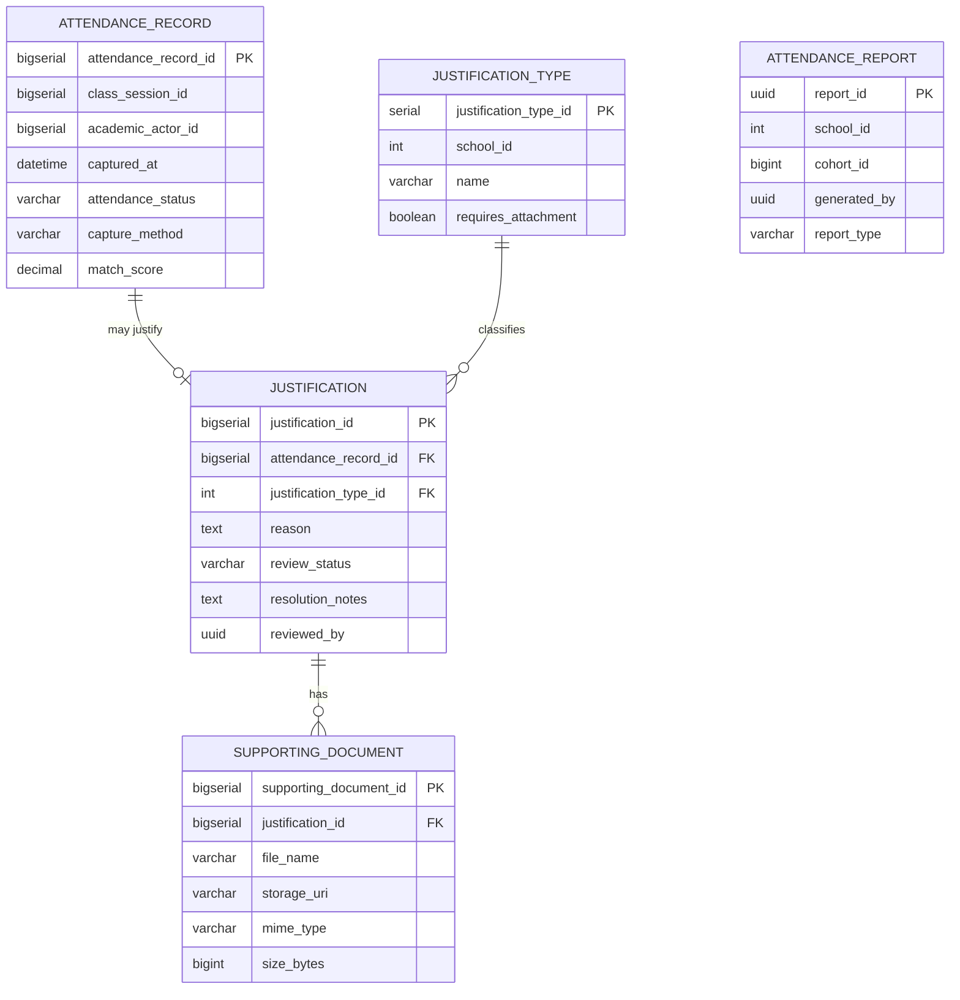

# Dominio: Attendance

> **Propietario:** Contexto delimitado Attendance
> **Motor de BD:** PostgreSQL 17 — transacciones ACID, seguimiento de asistencia por sesión
>
> **Justificación del motor:**
> - Los registros de asistencia requieren integridad transaccional (un registro por actor por sesión).
> - El flujo de justificaciones (Pending/Approved/Rejected) requiere garantías ACID.
> - Los documentos de soporte se gestionan por separado para mayor flexibilidad.

---

## Principios de diseño

- Attendance **NO** tiene FK hacia Scheduling ni Academic.
- `class_session_id` y `academic_actor_id` son IDs externos.
- La asistencia solo puede registrarse mientras la sesión asociada esté `Open` (Abierta).

---

## 1. Tabla: attendance_record

**Propósito:** Registro individual de asistencia de un academic_actor en una class_session.

```sql
-- Native ENUMs: CREATE TYPE attendance.attendance_status AS ENUM ('Present','Absent','Late','Justified');
-- CREATE TYPE attendance.capture_method AS ENUM ('FACIAL','MANUAL','IOT','IMPORT');
CREATE TABLE attendance_record (
  -- Business fields
  attendance_record_id  BIGSERIAL   PRIMARY KEY,
  class_session_id      BIGINT      NOT NULL,
  academic_actor_id     BIGINT      NOT NULL,
  captured_at           TIMESTAMP,

  -- Status fields
  attendance_status     attendance.attendance_status NOT NULL,
  capture_method        attendance.capture_method NOT NULL,
  match_score           DECIMAL(5,4),

  -- Audit (in all tables)
  created_at            TIMESTAMP NOT NULL DEFAULT NOW(),
  updated_at            TIMESTAMP NOT NULL DEFAULT NOW(),
  deleted_at            TIMESTAMP,
  created_by            UUID,
  updated_by            UUID,
  deleted_by            UUID,
  row_version           BIGINT      NOT NULL DEFAULT 1
);

CREATE UNIQUE INDEX uq_attendance_session_actor
  ON attendance_record (class_session_id, academic_actor_id);
CREATE INDEX idx_attendance_actor ON attendance_record (academic_actor_id);
CREATE INDEX idx_attendance_deleted ON attendance_record (deleted_at) WHERE deleted_at IS NULL;
```

**Diccionario de datos:**

| Columna | Tipo | Descripción | Ejemplo |
|--------|------|-------------|---------|
| attendance_record_id | BIGSERIAL | Identificador incremental del registro | `1` |
| class_session_id | BIGINT | Sesión de clase (ID externo → Scheduling.class_session) | `1` |
| academic_actor_id | BIGINT | Actor al que se hace seguimiento (ID externo → Academic.academic_actor) | `1` |
| captured_at | TIMESTAMP | Cuándo se capturó la asistencia | `2024-06-01T08:05:00Z` |
| attendance_status | ENUM | Estado: Present (Presente), Absent (Ausente), Late (Tarde), Justified (Justificada) | `Present` |
| capture_method | ENUM | Método: FACIAL, MANUAL, IOT, IMPORT | `FACIAL` |
| match_score | DECIMAL(5,4) | Puntaje de coincidencia biométrica (0.0000..1.0000) | `0.9876` |
| created_at | TIMESTAMP | Cuándo se creó el registro | `2024-06-01T08:05:00Z` |
| updated_at | TIMESTAMP | Cuándo se actualizó el registro por última vez | `2024-06-01T08:05:00Z` |
| deleted_at | TIMESTAMP | NULL = activo; con valor = eliminado lógicamente | `NULL` |
| created_by | UUID | Usuario que creó este registro | `550e8400-...` |
| updated_by | UUID | Usuario que actualizó este registro por última vez | `550e8400-...` |
| deleted_by | UUID | Usuario que eliminó lógicamente este registro | `NULL` |
| row_version | BIGINT | Contador de versión para bloqueo optimista | `1` |

**Decisiones de modelado:**
1. Un registro por actor por sesión (unicidad sobre class_session_id, academic_actor_id).
2. `match_score` almacena la confianza biométrica de las capturas FACIAL.
3. `capture_method` reemplaza el antiguo campo `source` con un vocabulario controlado.

---

## 2. Tabla: justification_type

**Propósito:** Catálogo de tipos de justificación para ausencias.

```sql
CREATE TABLE justification_type (
  -- Business fields
  justification_type_id  SERIAL      PRIMARY KEY,
  -- NULL = global type, NOT NULL = per-school custom type
  school_id              INT         NULL,
  name                   VARCHAR     NOT NULL,
  description            VARCHAR,
  requires_attachment    BOOLEAN     NOT NULL DEFAULT false,

  -- Status fields
  status                 BOOLEAN     NOT NULL DEFAULT true,

  -- Audit (in all tables)
  created_at             TIMESTAMP NOT NULL DEFAULT NOW(),
  updated_at             TIMESTAMP NOT NULL DEFAULT NOW(),
  deleted_at             TIMESTAMP,
  created_by             UUID,
  updated_by             UUID,
  deleted_by             UUID,
  row_version            BIGINT      NOT NULL DEFAULT 1
);

CREATE UNIQUE INDEX uq_justification_type_school_name ON justification_type (school_id, name);
-- In PostgreSQL NULL != NULL: the composite UNIQUE does not cover globals.
CREATE UNIQUE INDEX uq_justification_type_global_name ON justification_type (name) WHERE school_id IS NULL;
CREATE INDEX idx_justification_type_school ON justification_type (school_id);
```

**Diccionario de datos:**

| Columna | Tipo | Descripción | Ejemplo |
|--------|------|-------------|---------|
| justification_type_id | SERIAL | Identificador incremental del tipo | `1` |
| school_id | INT | NULL = global, NOT NULL = personalizado por sede | `NULL` |
| name | VARCHAR | Nombre del tipo (único por sede + único parcial para globales) | `Medical leave` |
| description | VARCHAR | Descripción del tipo | `Validated medical incapacity` |
| requires_attachment | BOOLEAN | Indica si se requiere documento de soporte | `true` |
| status | BOOLEAN | Indicador de activo/inactivo | `true` |
| created_at | TIMESTAMP | Cuándo se creó el registro | `2024-01-15T10:30:00Z` |
| updated_at | TIMESTAMP | Cuándo se actualizó el registro por última vez | `2024-01-15T10:30:00Z` |
| deleted_at | TIMESTAMP | NULL = activo; con valor = eliminado lógicamente | `NULL` |
| created_by | UUID | Usuario que creó este registro | `550e8400-...` |
| updated_by | UUID | Usuario que actualizó este registro por última vez | `550e8400-...` |
| deleted_by | UUID | Usuario que eliminó lógicamente este registro | `NULL` |
| row_version | BIGINT | Contador de versión para bloqueo optimista | `1` |

---

## 3. Tabla: justification

**Propósito:** Solicitud de justificación para una ausencia específica. Vinculada 1:1 con attendance_record.

```sql
-- Native ENUM: CREATE TYPE attendance.review_status AS ENUM ('Pending','Approved','Rejected');
CREATE TABLE justification (
  -- Business fields
  justification_id        BIGSERIAL   PRIMARY KEY,
  attendance_record_id    BIGINT      NOT NULL UNIQUE,
  justification_type_id   INT         NOT NULL,
  reason                  TEXT        NOT NULL,
  submitted_at            TIMESTAMP NOT NULL,

  -- Status fields
  review_status           attendance.review_status NOT NULL,
  resolution_notes        TEXT        NULL,

  -- Audit (in all tables)
  created_at              TIMESTAMP NOT NULL DEFAULT NOW(),
  updated_at              TIMESTAMP NOT NULL DEFAULT NOW(),
  deleted_at              TIMESTAMP,
  created_by              UUID,
  updated_by              UUID,
  deleted_by              UUID,
  row_version             BIGINT      NOT NULL DEFAULT 1,

  -- Extra
  reviewed_by             UUID,
  reviewed_at             TIMESTAMP
);

CREATE INDEX idx_justification_type ON justification (justification_type_id);
CREATE INDEX idx_justification_reviewer ON justification (reviewed_by);
```

**Diccionario de datos:**

| Columna | Tipo | Descripción | Ejemplo |
|--------|------|-------------|---------|
| justification_id | BIGSERIAL | Identificador incremental de la justificación | `1` |
| attendance_record_id | BIGINT | Registro de asistencia (FK → attendance_record, UNIQUE) | `1` |
| justification_type_id | INT | Tipo de justificación (FK → justification_type) | `1` |
| reason | TEXT | Motivo detallado de la justificación | `Medical appointment` |
| submitted_at | TIMESTAMP | Cuándo se presentó la justificación | `2024-06-01T10:00:00Z` |
| review_status | ENUM | Estado: Pending (Pendiente), Approved (Aprobada), Rejected (Rechazada) | `Pending` |
| resolution_notes | TEXT | Notas de resolución de la revisión | `Approved — certificate verified` |
| created_at | TIMESTAMP | Cuándo se creó el registro | `2024-06-01T10:00:00Z` |
| updated_at | TIMESTAMP | Cuándo se actualizó el registro por última vez | `2024-06-01T10:00:00Z` |
| deleted_at | TIMESTAMP | NULL = activo; con valor = eliminado lógicamente | `NULL` |
| created_by | UUID | Usuario que creó este registro | `550e8400-...` |
| updated_by | UUID | Usuario que actualizó este registro por última vez | `550e8400-...` |
| deleted_by | UUID | Usuario que eliminó lógicamente este registro | `NULL` |
| row_version | BIGINT | Contador de versión para bloqueo optimista | `1` |
| reviewed_by | UUID | Usuario revisor (ID externo → Identity.app_user) | `550e8400-...` |
| reviewed_at | TIMESTAMP | Cuándo se revisó la justificación | `2024-06-02T14:00:00Z` |

---

## 4. Tabla: supporting_document

**Propósito:** Archivos adjuntos a una justificación (certificados médicos, etc.).

```sql
CREATE TABLE supporting_document (
  -- Business fields
  supporting_document_id  BIGSERIAL   PRIMARY KEY,
  justification_id        BIGINT      NOT NULL,
  file_name               VARCHAR     NOT NULL,
  storage_uri             VARCHAR     NOT NULL,
  mime_type               VARCHAR     NOT NULL,
  size_bytes              BIGINT      NOT NULL,

  -- Audit (in all tables)
  created_at              TIMESTAMP NOT NULL DEFAULT NOW(),
  updated_at              TIMESTAMP NOT NULL DEFAULT NOW(),
  deleted_at              TIMESTAMP,
  created_by              UUID,
  updated_by              UUID,
  deleted_by              UUID,
  row_version             BIGINT      NOT NULL DEFAULT 1
);

CREATE INDEX idx_document_justification ON supporting_document (justification_id);
```

## 5. Tabla: attendance_report (proyección derivada, fuera del núcleo 3NF)

> **Proyección derivada (JSONB, sin FKs):** se mantiene en el modelo completo pero fuera del núcleo 3NF. Los ids entre contextos son solo lógicos.

```sql
CREATE TABLE attendance_report (
  -- Business fields
  report_id     UUID        PRIMARY KEY DEFAULT gen_random_uuid(),
  school_id     INT         NULL,
  cohort_id     BIGINT      NULL,
  generated_by  UUID        NULL,
  report_type   VARCHAR     NOT NULL,
  filters       JSONB       NULL,
  result        JSONB       NULL,
  generated_at  TIMESTAMP NOT NULL,

  -- Audit (in all tables)
  created_at    TIMESTAMP NOT NULL DEFAULT NOW(),
  updated_at    TIMESTAMP NOT NULL DEFAULT NOW(),
  deleted_at    TIMESTAMP,
  created_by    UUID,
  updated_by    UUID,
  deleted_by    UUID,
  row_version   BIGINT      NOT NULL DEFAULT 1
);

CREATE INDEX idx_report_school ON attendance_report (school_id);
CREATE INDEX idx_report_cohort ON attendance_report (cohort_id);
```

**Diccionario de datos (attendance_report):**

| Columna | Tipo | Descripción | Ejemplo |
|--------|------|-------------|---------|
| report_id | UUID | Identificador del informe | `550e8400-...` |
| school_id | INT | Entre contextos hacia Academic.school (sin FK) | `1` |
| cohort_id | BIGINT | Entre contextos hacia Academic.cohort (sin FK) | `1` |
| generated_by | UUID | Entre contextos hacia Identity.app_user (sin FK) | `550e8400-...` |
| report_type | VARCHAR | Tipo de informe | `cohort-summary` |
| filters | JSONB | Filtros de entrada | `{"cohort_id":1}` |
| result | JSONB | Resultado calculado | `{"present":25}` |
| generated_at | TIMESTAMP | Momento de generación | `2024-06-02T14:00:00Z` |

---

**Diccionario de datos (supporting_document):**

| Columna | Tipo | Descripción | Ejemplo |
|--------|------|-------------|---------|
| supporting_document_id | BIGSERIAL | Identificador incremental del documento | `1` |
| justification_id | BIGINT | Justificación padre (FK → justification) | `1` |
| file_name | VARCHAR | Nombre original del archivo | `medical_cert.pdf` |
| storage_uri | VARCHAR | Ruta de almacenamiento o URL | `/docs/justifications/001/medical_cert.pdf` |
| mime_type | VARCHAR | Tipo MIME del archivo | `application/pdf` |
| size_bytes | BIGINT | Tamaño del archivo en bytes | `245760` |
| created_at | TIMESTAMP | Cuándo se creó el registro | `2024-06-01T10:00:00Z` |
| updated_at | TIMESTAMP | Cuándo se actualizó el registro por última vez | `2024-06-01T10:00:00Z` |
| deleted_at | TIMESTAMP | NULL = activo; con valor = eliminado lógicamente | `NULL` |
| created_by | UUID | Usuario que creó este registro | `550e8400-...` |
| updated_by | UUID | Usuario que actualizó este registro por última vez | `550e8400-...` |
| deleted_by | UUID | Usuario que eliminó lógicamente este registro | `NULL` |
| row_version | BIGINT | Contador de versión para bloqueo optimista | `1` |

---

## 6. Diagrama de relaciones



> `attendance_report` no tiene FKs (proyección derivada). Los ids entre contextos son solo lógicos.

---

## 7. Relaciones entre contextos

| Origen | Destino | Tipo de referencia | Mecanismo |
|------|----|----------------|-----------|
| Attendance_Record.class_session_id | Scheduling.Class_Session.class_session_id | ID externo (sin FK) | Referencia entre contextos por BIGINT |
| Attendance_Record.academic_actor_id | Academic.Academic_Actor.academic_actor_id | ID externo (sin FK) | Referencia entre contextos por BIGINT |
| Justification.reviewed_by | Identity.App_User.user_id | ID externo (sin FK) | Referencia entre contextos por UUID |
| Attendance_Report.school_id / cohort_id / generated_by | Academic / Identity | ID externo (sin FK) | Proyección derivada, sin FKs |

---

## 8. Correlaciones

- Entidades de dominio que se mapean a estas tablas → `02-domain/entities-and-rules.md`
- Patrón Saga y Outbox para consistencia distribuida → `05-architecture/pattern-guide.md`
- Datos de cada servicio en detalle → `09-microservices/services/attendance-service/data-model.md`
- Cómo se accede a los datos vía API → `07-api/contracts/openapi/`
