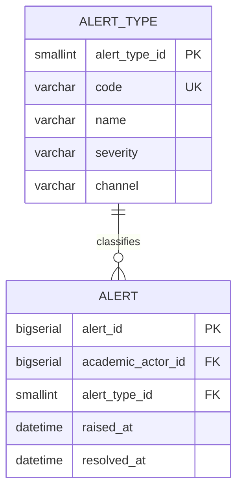

# Dominio: Notification

> **Propietario:** Contexto delimitado Notification
> **Motor de BD:** PostgreSQL 17 — transacciones ACID, gestión del ciclo de vida de alertas
>
> **Justificación del motor:**
> - Las alertas requieren seguimiento confiable de estado (generada → resuelta).
> - Los tipos de alerta se basan en catálogo para facilitar la extensión.

---

## Principios de diseño

- Notification es dueño de: alert_type, alert.
- `academic_actor_id` es una referencia externa hacia Academic — sin FK entre contextos.

---

## 1. Tabla: alert_type

**Propósito:** Catálogo de tipos de alerta (p. ej., umbral de ausencias alcanzado, conflicto de horario).

```sql
CREATE TABLE alert_type (
  -- Business fields
  alert_type_id SMALLINT    PRIMARY KEY,
  code          VARCHAR     NOT NULL UNIQUE,
  name          VARCHAR     NOT NULL,
  severity      VARCHAR     NOT NULL CHECK (severity IN ('INFO','WARNING','CRITICAL')),
  channel       VARCHAR     NOT NULL DEFAULT 'DASHBOARD' CHECK (channel IN ('DASHBOARD','EMAIL','PUSH')),

  -- Audit (in all tables)
  created_at    TIMESTAMP NOT NULL DEFAULT NOW(),
  updated_at    TIMESTAMP NOT NULL DEFAULT NOW(),
  deleted_at    TIMESTAMP,
  created_by    UUID,
  updated_by    UUID,
  deleted_by    UUID,
  row_version   BIGINT      NOT NULL DEFAULT 1
);
```

**Diccionario de datos:**

| Columna | Tipo | Descripción | Ejemplo |
|--------|------|-------------|---------|
| alert_type_id | SMALLINT | Identificador incremental del tipo | `1` |
| code | VARCHAR | Código único del tipo | `ABSENCE_THRESHOLD` |
| name | VARCHAR | Nombre del tipo | `Absence threshold reached` |
| severity | VARCHAR | INFO (Informativa) / WARNING (Advertencia) / CRITICAL (Crítica) | `WARNING` |
| channel | VARCHAR | DASHBOARD (Tablero) / EMAIL (Correo) / PUSH | `DASHBOARD` |
| created_at | TIMESTAMP | Cuándo se creó el registro | `2024-01-15T10:30:00Z` |
| updated_at | TIMESTAMP | Cuándo se actualizó el registro por última vez | `2024-01-15T10:30:00Z` |
| deleted_at | TIMESTAMP | NULL = activo; con valor = eliminado lógicamente | `NULL` |
| created_by | UUID | Usuario que creó este registro | `550e8400-...` |
| updated_by | UUID | Usuario que actualizó este registro por última vez | `550e8400-...` |
| deleted_by | UUID | Usuario que eliminó lógicamente este registro | `NULL` |
| row_version | BIGINT | Contador de versión para bloqueo optimista | `1` |

---

## 2. Tabla: alert

**Propósito:** Alerta generada para un academic_actor.

```sql
CREATE TABLE alert (
  -- Business fields
  alert_id          BIGSERIAL   PRIMARY KEY,
  academic_actor_id BIGINT      NOT NULL,
  alert_type_id     SMALLINT    NOT NULL,
  raised_at         TIMESTAMP NOT NULL,
  resolved_at       TIMESTAMP,

  -- Audit (in all tables)
  created_at        TIMESTAMP NOT NULL DEFAULT NOW(),
  updated_at        TIMESTAMP NOT NULL DEFAULT NOW(),
  deleted_at        TIMESTAMP,
  created_by        UUID,
  updated_by        UUID,
  deleted_by        UUID,
  row_version       BIGINT      NOT NULL DEFAULT 1
);

CREATE INDEX idx_alert_actor ON alert (academic_actor_id);
CREATE INDEX idx_alert_type ON alert (alert_type_id);
```

**Diccionario de datos:**

| Columna | Tipo | Descripción | Ejemplo |
|--------|------|-------------|---------|
| alert_id | BIGSERIAL | Identificador incremental de la alerta | `1` |
| academic_actor_id | BIGINT | Actor al que corresponde esta alerta (ID externo → Academic.academic_actor) | `1` |
| alert_type_id | SMALLINT | Tipo de alerta (FK → alert_type) | `1` |
| raised_at | TIMESTAMP | Cuándo se generó la alerta | `2024-06-01T10:00:00Z` |
| resolved_at | TIMESTAMP | Cuándo se resolvió la alerta (NULL = sin resolver) | `NULL` |
| created_at | TIMESTAMP | Cuándo se creó el registro | `2024-06-01T10:00:00Z` |
| updated_at | TIMESTAMP | Cuándo se actualizó el registro por última vez | `2024-06-01T10:00:00Z` |
| deleted_at | TIMESTAMP | NULL = activo; con valor = eliminado lógicamente | `NULL` |
| created_by | UUID | Usuario que creó este registro | `550e8400-...` |
| updated_by | UUID | Usuario que actualizó este registro por última vez | `550e8400-...` |
| deleted_by | UUID | Usuario que eliminó lógicamente este registro | `NULL` |
| row_version | BIGINT | Contador de versión para bloqueo optimista | `1` |

---

## 3. Diagrama de relaciones



---

## 4. Relaciones entre contextos

| Origen | Destino | Tipo de referencia | Mecanismo |
|------|----|----------------|-----------|
| Alert.academic_actor_id | Academic.Academic_Actor.academic_actor_id | ID externo (sin FK) | Referencia entre contextos por BIGINT |

---

## 5. Correlaciones

- Entidades de dominio que se mapean a estas tablas → `02-domain/entities-and-rules.md`
- Patrón Saga y Outbox para consistencia distribuida → `05-architecture/pattern-guide.md`
- Datos de cada servicio en detalle → `09-microservices/services/notification-service/data-model.md`
- Cómo se accede a los datos vía API → `07-api/contracts/openapi/`
