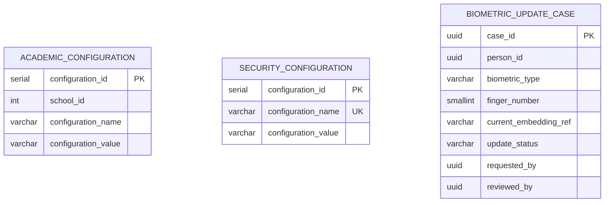

# Dominio: Configuration

> **Propietario:** Contexto delimitado Configuration
> **Motor de BD:** PostgreSQL 17 — almacenamiento de configuración clave-valor con estructura relacional
>
> **Justificación del motor:**
> - Los parámetros de configuración requieren transacciones ACID para actualizaciones seguras.
> - `biometric_update_case` requiere seguimiento relacional de estado (Pending/Approved/Rejected).

---

## Principios de diseño

- Configuration es transversal — no se relaciona directamente con User/Person.
- `biometric_update_case` es la tabla unificada para solicitudes de actualización facial y de huella.
- **El propietario lógico es Biometric (DBML v7):** este esquema la aloja solo de forma transitoria por compatibilidad con Liquibase/servicios. Ver `06-biometric.md`.

---

## 1. Tabla: academic_configuration

**Propósito:** Parámetros configurables por sede que afectan el comportamiento académico.

```sql
CREATE TABLE academic_configuration (
  -- Business fields
  configuration_id    SERIAL      PRIMARY KEY,
  school_id           INT         NOT NULL,
  configuration_name  VARCHAR     NOT NULL,
  configuration_value VARCHAR     NOT NULL,
  description         VARCHAR,

  -- Audit (in all tables)
  created_at          TIMESTAMP NOT NULL DEFAULT NOW(),
  updated_at          TIMESTAMP NOT NULL DEFAULT NOW(),
  deleted_at          TIMESTAMP,
  created_by          UUID,
  updated_by          UUID,
  deleted_by          UUID,
  row_version         BIGINT      NOT NULL DEFAULT 1
);

CREATE UNIQUE INDEX uq_academic_configuration
  ON academic_configuration (school_id, configuration_name);
```

**Diccionario de datos:**

| Columna | Tipo | Descripción | Ejemplo |
|--------|------|-------------|---------|
| configuration_id | SERIAL | Identificador incremental de la configuración | `1` |
| school_id | INT | Sede propietaria (ID externo → Academic.school) | `1` |
| configuration_name | VARCHAR | Nombre del parámetro | `tardy_tolerance_minutes` |
| configuration_value | VARCHAR | Valor del parámetro (almacenado como cadena) | `15` |
| description | VARCHAR | Descripción del parámetro | `Minutes after start before marking late` |
| created_at | TIMESTAMP | Cuándo se creó el registro | `2024-01-15T10:30:00Z` |
| updated_at | TIMESTAMP | Cuándo se actualizó el registro por última vez | `2024-01-15T10:30:00Z` |
| deleted_at | TIMESTAMP | NULL = activo; con valor = eliminado lógicamente | `NULL` |
| created_by | UUID | Usuario que creó este registro | `550e8400-...` |
| updated_by | UUID | Usuario que actualizó este registro por última vez | `550e8400-...` |
| deleted_by | UUID | Usuario que eliminó lógicamente este registro | `NULL` |
| row_version | BIGINT | Contador de versión para bloqueo optimista | `1` |

---

## 2. Tabla: security_configuration

**Propósito:** Parámetros de configuración de seguridad de todo el sistema (no por sede).

```sql
CREATE TABLE security_configuration (
  -- Business fields
  configuration_id    SERIAL      PRIMARY KEY,
  configuration_name  VARCHAR     NOT NULL UNIQUE,
  configuration_value VARCHAR     NOT NULL,
  description         VARCHAR,

  -- Audit (in all tables)
  created_at          TIMESTAMP NOT NULL DEFAULT NOW(),
  updated_at          TIMESTAMP NOT NULL DEFAULT NOW(),
  deleted_at          TIMESTAMP,
  created_by          UUID,
  updated_by          UUID,
  deleted_by          UUID,
  row_version         BIGINT      NOT NULL DEFAULT 1
);
```

**Diccionario de datos:**

| Columna | Tipo | Descripción | Ejemplo |
|--------|------|-------------|---------|
| configuration_id | SERIAL | Identificador incremental de la configuración | `1` |
| configuration_name | VARCHAR | Nombre único del parámetro | `max_login_attempts` |
| configuration_value | VARCHAR | Valor del parámetro | `5` |
| description | VARCHAR | Descripción del parámetro | `Max failed logins before lockout` |
| created_at | TIMESTAMP | Cuándo se creó el registro | `2024-01-15T10:30:00Z` |
| updated_at | TIMESTAMP | Cuándo se actualizó el registro por última vez | `2024-01-15T10:30:00Z` |
| deleted_at | TIMESTAMP | NULL = activo; con valor = eliminado lógicamente | `NULL` |
| created_by | UUID | Usuario que creó este registro | `550e8400-...` |
| updated_by | UUID | Usuario que actualizó este registro por última vez | `550e8400-...` |
| deleted_by | UUID | Usuario que eliminó lógicamente este registro | `NULL` |
| row_version | BIGINT | Contador de versión para bloqueo optimista | `1` |

---

## 3. Tabla: biometric_update_case — propietario lógico Biometric, anfitrión físico Configuration (transitorio)

**Propósito:** Casos unificados para solicitar actualizaciones de embeddings faciales o de huella.

```sql
-- Native ENUMs (logical owner Biometric):
-- CREATE TYPE biometric.biometric_type AS ENUM ('FACIAL','FINGERPRINT');
-- CREATE TYPE biometric.update_status AS ENUM ('Pending','In_Review','Approved','Rejected');
CREATE TABLE biometric_update_case (
  -- Business fields
  case_id                 UUID        PRIMARY KEY,
  person_id               UUID        NOT NULL,
  biometric_type          biometric.biometric_type NOT NULL,
  finger_number           SMALLINT    NULL CHECK (finger_number BETWEEN 1 AND 10),
  current_embedding_ref   VARCHAR,
  reason                  TEXT        NOT NULL,

  -- Status fields
  update_status           biometric.update_status NOT NULL DEFAULT 'Pending',

  -- Audit (in all tables)
  created_at              TIMESTAMP NOT NULL DEFAULT NOW(),
  updated_at              TIMESTAMP NOT NULL DEFAULT NOW(),
  deleted_at              TIMESTAMP,
  created_by              UUID,
  updated_by              UUID,
  deleted_by              UUID,
  row_version             BIGINT      NOT NULL DEFAULT 1,

  -- Workflow
  requested_by            UUID        NOT NULL,
  requested_at            TIMESTAMP NOT NULL,
  reviewed_by             UUID,
  reviewed_at             TIMESTAMP,
  resolution_notes        TEXT,

  CONSTRAINT chk_finger_number CHECK (
    (biometric_type = 'FINGERPRINT' AND finger_number BETWEEN 1 AND 10)
    OR (biometric_type = 'FACIAL' AND finger_number IS NULL)
  )
);

CREATE INDEX idx_biometric_case_person ON biometric_update_case (person_id);
CREATE INDEX idx_biometric_case_person_type ON biometric_update_case (person_id, biometric_type);
CREATE INDEX idx_biometric_case_status ON biometric_update_case (update_status);
```

**Diccionario de datos:**

| Columna | Tipo | Descripción | Ejemplo |
|--------|------|-------------|---------|
| case_id | UUID | Identificador único de caso autogenerado | `550e8400-...` |
| person_id | UUID | Persona (ID externo → Identity.person) | `550e8400-...` |
| biometric_type | ENUM | FACIAL o FINGERPRINT | `FACIAL` |
| finger_number | SMALLINT | ID de dedo (1..10), solo si FINGERPRINT, NULL en otro caso | `1` |
| current_embedding_ref | VARCHAR | _id lógico en MongoDB (entre paradigmas, sin FK) | `507f1f77bcf86cd799439011` |
| reason | TEXT | Motivo de la solicitud de actualización | `Significant weight change` |
| update_status | ENUM | Estado: Pending (Pendiente), In_Review (En revisión), Approved (Aprobada), Rejected (Rechazada) | `Pending` |
| created_at | TIMESTAMP | Cuándo se creó el registro | `2024-06-01T10:00:00Z` |
| updated_at | TIMESTAMP | Cuándo se actualizó el registro por última vez | `2024-06-01T10:00:00Z` |
| deleted_at | TIMESTAMP | NULL = activo; con valor = eliminado lógicamente | `NULL` |
| created_by | UUID | Usuario que creó este registro | `550e8400-...` |
| updated_by | UUID | Usuario que actualizó este registro por última vez | `550e8400-...` |
| deleted_by | UUID | Usuario que eliminó lógicamente este registro | `NULL` |
| row_version | BIGINT | Contador de versión para bloqueo optimista | `1` |
| requested_by | UUID | Usuario solicitante, obligatorio (ID externo → Identity.app_user) | `550e8400-...` |
| requested_at | TIMESTAMP | Cuándo se presentó la solicitud, obligatorio | `2024-06-01T10:00:00Z` |
| reviewed_by | UUID | Usuario revisor (ID externo → Identity.app_user) | `550e8400-...` |
| reviewed_at | TIMESTAMP | Cuándo se revisó la solicitud | `2024-06-02T14:00:00Z` |
| resolution_notes | TEXT | Notas de la revisión | `Approved — new photo captured` |

**Decisiones de modelado:**
1. Tabla unificada: `biometric_type` distingue casos FACIAL vs FINGERPRINT.
2. `finger_number` solo se puebla cuando `biometric_type = FINGERPRINT` (`chk_finger_number`).
3. `current_embedding_ref` es una referencia lógica al documento MongoDB (entre paradigmas).
4. Flujo de estados: Pending → In_Review → Approved/Rejected (Pendiente → En revisión → Aprobada/Rechazada). `requested_by/requested_at` son obligatorios.

---

## 4. Diagrama de relaciones



---

## 5. Relaciones entre contextos

| Origen | Destino | Tipo de referencia | Mecanismo |
|------|----|----------------|-----------|
| Academic_Configuration.school_id | Academic.School.school_id | ID externo (sin FK) | Referencia entre contextos por SERIAL |
| Biometric_Update_Case.person_id | Identity.Person.person_id | ID externo (sin FK) | Referencia entre contextos por UUID |
| Biometric_Update_Case.current_embedding_ref | Biometric.Facial/Fingerprint_Embedding._id | ID externo (sin FK) | Referencia entre paradigmas (SQL → NoSQL) |
| Biometric_Update_Case.requested_by | Identity.App_User.user_id | ID externo (sin FK) | Referencia entre contextos por UUID |
| Biometric_Update_Case.reviewed_by | Identity.App_User.user_id | ID externo (sin FK) | Referencia entre contextos por UUID |

---

## 6. Correlaciones

- Entidades de dominio que se mapean a estas tablas → `02-domain/entities-and-rules.md`
- Patrón Saga y Outbox para consistencia distribuida → `05-architecture/pattern-guide.md`
- Datos de cada servicio en detalle → `09-microservices/services/configuration-service/data-model.md`
- Cómo se accede a los datos vía API → `07-api/contracts/openapi/`
